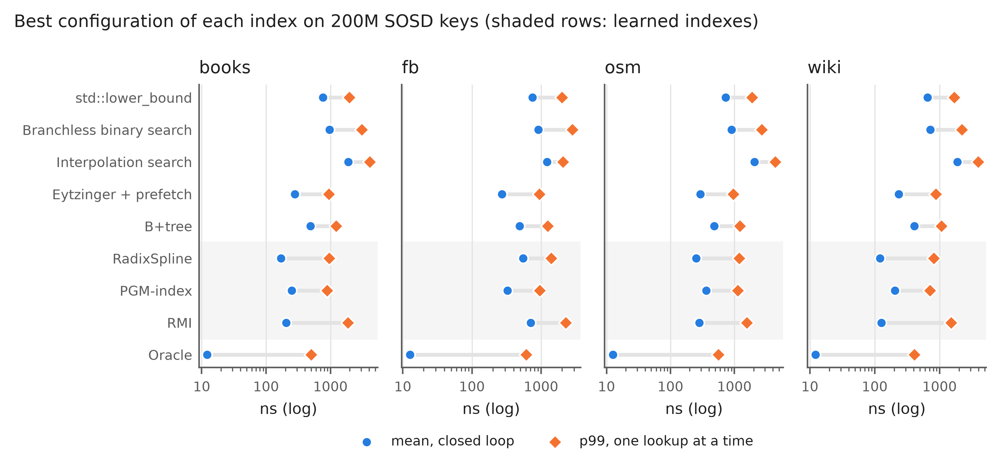
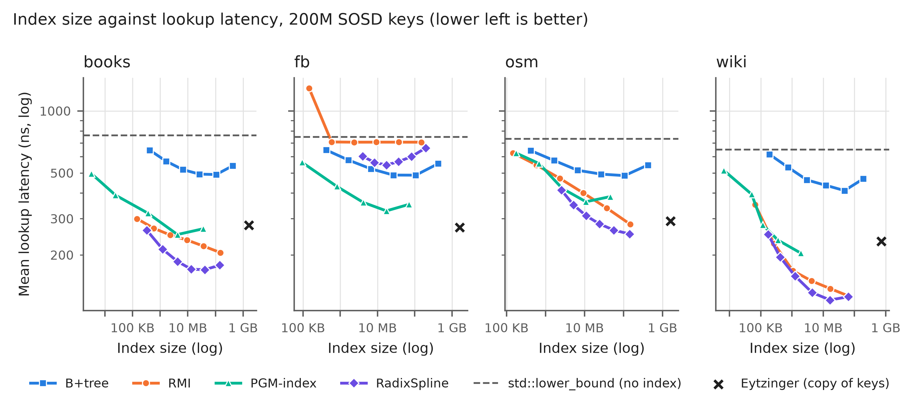
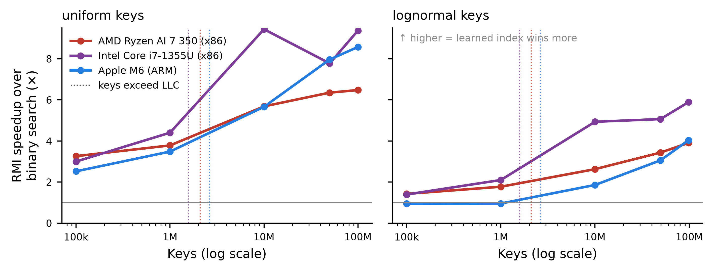

# Do Learned Indexes Still Win on Modern Hardware?

*CIS 4930 Final Project, Team 01: Riyon Praveen, Vishakha Tiwari, Sevara Badriddinova, Tuan Khang Phan*

## Abstract

Learned indexes replace a search structure with a model that predicts where a key sits. We ask whether they still win on modern laptops against a tuned baseline, not `std::lower_bound`. On four 200M-key SOSD datasets, the best learned index is 2.3 to 5.4× faster than `std::lower_bound`, but only 1.2 to 1.9× faster than the best tuned search. On one dataset it loses: 20 outlier keys break two of three learned indexes. With equal memory it beats a B+tree by 1.5 to 3.5×. Counters explain the win: a learned lookup waits for 2 to 6 DRAM fills instead of 8 to 10. In cache, its lead is mostly avoided branch misses. Across three laptops the lead grows with data size; small data, inserts and range scans erase it. Against a B+tree, builds repay their cost within one lookup per key. Learned indexes pay off for large, read-mostly data without outliers.

## 1 Introduction

Database systems spend much of their time finding keys in sorted data. The usual tools are B+trees and binary search. Kraska et al. [1] proposed to replace them with a model that predicts where a key sits, a *learned index*. They reported lookups up to 70% faster than a cache-optimized B+tree, with an order of magnitude less memory.

The decision this report informs is practical. Should a system that looks up keys in large, read-mostly sorted arrays use a learned index, or a well-tuned non-learned search? Two things make the 2018 answer uncertain. Hardware has changed: caches are larger, ARM sits next to x86, and a lookup in a large array mostly waits on main memory. And learned indexes are usually compared with `std::lower_bound`, not with the best non-learned search tuned with the same effort.

We benchmark four learned indexes (RMI, PGM-index, RadixSpline and ALEX) against five tuned non-learned searches and an oracle. We use four 200M-key real datasets and synthetic keys, on three laptop CPUs (AMD and Intel x86, Apple ARM). Our claims, each on the course's ladder of evidence:

- **Rung 1: learned indexes are better.** On four 200M-key real datasets, the best learned index is 2.3 to 5.4× faster than `std::lower_bound`, but only 1.2 to 1.9× faster than the best tuned search, and slower on one dataset. At equal memory it beats a B+tree by 1.5 to 3.5× (Section 5).
- **Rung 2: because they wait for fewer memory accesses.** Out of cache, a learned lookup waits for 2 to 6 DRAM fills, against 8 to 10 dependent fills for a B+tree or a branchless search, and short independent lookups overlap well. In cache, its lead over `std::lower_bound` is a lead in branch misses, which a branchless search removes (Section 6).
- **Rung 3: except on outliers, small data, changing data and some CPUs.** On fb, 20 outlier keys out of 200M make the RMI nearly as slow as binary search, and removing them speeds it up 3.2×. A tuned search wins while the keys fit in cache, the RMI's p99 is 1.4 to 2.4× the PGM-index's, inserts and long scans erase ALEX's lead, and on the Apple M6 a small-data win turns into a loss (Section 7).
- **Rung 4: and the build pays off quickly.** Training needs no labels or GPU. Against a B+tree, the build is repaid after 0.03 to 0.28 lookups per key (Section 8).

Sections 2 to 4 describe the baselines, the learned indexes and the setup. Sections 5 to 8 answer the six questions of the course: is it better, why, where does it fail, does it transfer, what does it cost, and would anyone use it.

## 2 Background and baselines

An index over a sorted array of 64-bit keys answers a lookup with the position of the first key that is not smaller than the query. Every structure in this report returns that position, and our drivers check it for every query before timing. Without machine learning, the options are:

- **Binary search** (`std::lower_bound`). It needs no extra memory and about log2 n dependent reads.
- **Branchless binary search.** The same comparisons, with a conditional move instead of a branch. It never mispredicts, but it cannot run ahead of a slow load either.
- **Eytzinger layout with prefetching** [6]. A second copy of the keys in breadth-first tree order, so the next levels of the search share one prefetched cache line.
- **Interpolation search.** It probes where a straight line between the end keys of the range puts the query (up to 8 probes, then binary search). This is a two-point "model" with no training.
- **B+tree** (STX B+tree 0.9, the copy SOSD uses). As in SOSD, it indexes every s-th key and finishes with a binary search inside the gap, so s sets its size.
- **Hash table.** It answers only exact-match lookups and cannot find a lower bound, so it is not in our main comparison.

**Tuning at the same budget.** All baselines run in the same driver as the learned indexes, on the same keys and queries, with the same compiler flags and timing loop. The B+tree gets a size sweep like each learned index (6 values of s, from 8 to 8192). We report the best setting of every index, and the best setting under equal memory budgets. We call a learned index better only if it beats the fastest of these, not `std::lower_bound`.

**Oracle.** The oracle is given each query's true position and only reads that key. No index can do less work, so the gap to the oracle bounds what a better model could still gain.

## 3 Approach

A learned index treats a lookup as regression. The model maps a key to its position, which is the cumulative distribution of the keys scaled by n. The training labels are the positions themselves, so labels cost nothing. Training is a fit over the sorted keys when the index is built. A lookup evaluates the model, then searches a small window around the prediction. Each index stores its largest prediction error at build time, so the window always contains the answer. A bad prediction costs time, but it can never return a wrong result.

We test four learned indexes. Each has a setting that trades memory for accuracy.

**Table 1. Learned indexes and the settings we sweep.**

| Index | Model | Size setting (values swept) |
|---|---|---|
| RMI [1] | a linear root sends the key to one of many linear leaves | leaves: n/32 to n/32768 (6 values) |
| PGM-index [3] | linear segments with error at most ε, searched recursively | ε from 8 to 2048 (5 values) |
| RadixSpline [4] | a spline with bounded error, plus a table on key prefixes | (radix bits, error) from (24, 8) to (14, 256) (6 values) |
| ALEX [5] | an adaptive tree of linear models over gapped arrays; supports inserts | library defaults (Objective 4 only) |

The RMI is our own two-stage linear version. PGM-index, RadixSpline and ALEX are the authors' libraries at pinned commits. Four drivers share this code:

- `wp12` (questions 1 and 2): every index and baseline above on the four SOSD datasets. It reports mean, median and 99th-percentile (p99) latency, build time and index size.
- `learned-index-bench` (questions 1 and 4): the RMI, the binary search variants and the oracle on synthetic keys from 100K to 100M, run on three laptops.
- `wp3` (question 2): hardware counters per lookup, read with Linux `perf_event_open`.
- `wp4` (question 3): ALEX, the B+tree and two PGM variants under inserts, range scans and bulk loading.

The budget of a learned index is its build time (training) and its size (the model). Inference is the lookup itself. We report all three.

## 4 Setup

**Table 2. Machines. All runs are single-threaded.**

| Machine | Details | Used for |
|---|---|---|
| AMD laptop, Windows | Ryzen AI 7 350 (4 Zen 5 and 4 Zen 5c cores; 1 MB L2 per core; 16 MB L3); 15.3 GB; Windows 11; MinGW g++ 16.1, `-O3 -march=native`; pinned to one core; AC power (Section 9 notes one exception) | questions 1, 2, 4 |
| AMD laptop, Linux VM | the same laptop; Ubuntu 24.04 under WSL2; g++ 13.3; pinned | question 2 (counters) |
| Intel laptop | Core i7-1355U (2 performance and 8 efficiency cores; 12 MB L3); OS, compiler, pinning and power not recorded | question 4 |
| Apple laptop | M6 MacBook Pro; 16 GB; macOS 27.2; Apple clang 17, `-O3 -mcpu=native`; macOS cannot pin threads | questions 3, 4 |

**Workloads.**

- **SOSD data [2]**, 200M keys each: books (Amazon book popularity), fb (Facebook user IDs), osm (OpenStreetMap cell IDs) and wiki (Wikipedia edit timestamps). We downloaded them from Harvard Dataverse and checked each file's MD5. Duplicate keys are removed, which leaves 200M keys in books, fb and osm and 90.4M in wiki. We also drop one fb key, 2^64 - 1, which PGM-index reserves as a sentinel.
- **Synthetic data**: uniform and lognormal(0, 2) keys from 100K to 100M, generated from fixed seeds.
- **Workloads beyond lookups** (question 3): 10M-key samples of books and osm, and seeded synthetic sets, under mixed lookups and inserts, range scans and bulk loading.
- **Queries**: 2M keys drawn at random from the data (fixed seed). The same queries go to every index.

**Two latency measures.** The *mean* is the time for all 2M lookups in a loop, divided by 2M. Consecutive lookups are independent, so the core can overlap their memory accesses; 1000 / mean is the single-thread throughput in million lookups per second. The *p50* and *p99* time each lookup on its own between serializing timestamp reads. Then lookups cannot overlap, and each pays its full latency. The timer costs 20 to 30 ns, which we measure and subtract, and it ticks in 10 ns steps.

**Runs and checks.** For SOSD, every number is the median of 3 trials. In each trial a mean is the median of 5 timed passes after a warm-up pass, and a percentile is the median of 3 passes over 500K queries. Other experiments state their repeats with their tables. Before timing, an index must return the right position for every query, or the driver stops. Each run folder records the machine, compiler, flags, power source and data checksums, and scripts rebuild every table from the raw files.

## 5 Is it better?

**Against a tuned baseline.** Table 3 compares, on each SOSD dataset, the best setting of any learned index with the best tuned non-learned search. Figure 1 shows the best setting of every index.

**Table 3. Main result: mean lookup latency in ns on 200M SOSD keys (AMD laptop, median of 3 trials). The best tuned non-learned search is the Eytzinger layout on every dataset; it needs a second copy of the keys (1.6 GB, 0.7 GB for wiki).**

| Dataset | `std::lower_bound` | Best tuned non-learned | Best learned (size) | Learned vs tuned | Learned vs `std::lower_bound` | Oracle |
|---|---:|---|---|---:|---:|---:|
| books | 762 | Eytzinger 279 | RadixSpline, 22 bits, error 16: **170** (41 MB) | 1.64× | 4.5× | 12 |
| fb | 749 | Eytzinger 272 | PGM, ε = 32: **327** (17 MB) | 0.83× | 2.3× | 13 |
| osm | 733 | Eytzinger 292 | RadixSpline, 24 bits, error 8: **253** (144 MB) | 1.16× | 2.9× | 13 |
| wiki | 649 | Eytzinger 233 | RadixSpline, 22 bits, error 16: **121** (17 MB) | 1.93× | 5.4× | 12 |

- Against `std::lower_bound`, the usual bar, the best learned index is 2.3 to 5.4× faster.
- Against the best tuned search, the gain is much smaller: 1.6× on books and 1.9× on wiki, but only 1.16× on osm, where RadixSpline needs 144 MB to get there. On fb the learned index loses (0.83×).
- The best learned index is still 10 to 26× slower than the oracle, so better models have room to gain.
- On synthetic keys the picture is the same. At 100M keys the RMI's lead falls from 6.4× over `std::lower_bound` to 2.5× over the best tuned search (uniform keys), and from 3.9× to 1.5× (lognormal keys).

**Figure 1.** Best setting of every index on each dataset: closed-loop mean (circles) and p99 of lookups timed one at a time (diamonds). Shaded rows are learned indexes.

**At the same memory budget.** The Eytzinger layout's speed costs a full copy of the keys. Figure 2 plots every setting of every index by size. With at most 10 MB of index, which is 0.6% of the keys' size, the learned indexes win clearly (Table 4).

**Table 4. Fastest index with at most 10 MB of extra memory (mean ns). The 0-byte searches count as non-learned options.**

| Dataset | Best non-learned, at most 10 MB | Best learned, at most 10 MB | Learned faster by |
|---|---|---|---:|
| books | B+tree every 512: 519 ns (6.7 MB) | RadixSpline 18 bits, error 64: 186 ns (4.2 MB) | 2.8× |
| fb | B+tree every 512: 524 ns (6.7 MB) | PGM ε = 128: 360 ns (4.1 MB) | 1.5× |
| osm | B+tree every 512: 515 ns (6.7 MB) | RadixSpline 16 bits, error 128: 350 ns (5.2 MB) | 1.5× |
| wiki | B+tree every 512: 463 ns (3.0 MB) | RadixSpline 20 bits, error 32: 131 ns (4.4 MB) | 3.5× |

**Figure 2.** Mean lookup latency against index size for every setting. The dashed line is `std::lower_bound`, which needs no index; the cross is the Eytzinger layout.

Except for the RMI on fb, every learned family sits below the B+tree at every size in Figure 2. With 1 MB, the best learned index is 1.2 to 2.7× faster than the best B+tree of that size, and a 24 KB PGM-index is still nearly 2× faster than `std::lower_bound` on books. The fastest learned settings take 17 to 41 MB, 1 to 3% of the keys' size, and settings of about 4 MB are within 10% of them, except on osm.

**Answer.** Yes, on three of four datasets, but by 1.2 to 1.9× over the best tuned search, not the 2.3 to 5.4× measured against `std::lower_bound`. Per byte of memory the learned indexes win clearly: 1.5 to 3.5× over a B+tree of the same size.

## 6 Why it works

We read hardware counters around the lookup loop on the AMD laptop, under Linux (same keys and queries as the synthetic runs). A pointer-chase calibration confirmed that each counter reports the expected cache level inside the virtual machine. Table 5 shows two regimes.

**Table 5. Per lookup, uniform keys, median of 3 trials. RMI is the fastest of 4 leaf counts.**

| Index | 100K keys (in L2): ns | Branch misses | 100M keys (in DRAM): ns | DRAM fills | Page walks |
|---|---:|---:|---:|---:|---:|
| `std::lower_bound` | 118 | 9.4 | 707 | 43.5 | 27.5 |
| Branchless binary search | **26** | 0.0 | 1,094 | 8.8 | 6.8 |
| B+tree | 77 | 5.1 | 832 | 8.3 | 2.8 |
| PGM-index | 69 | 3.8 | 228 | 5.3 | 1.1 |
| RadixSpline | 54 | 2.8 | 128 | 3.2 | 1.1 |
| RMI | 38 | 1.6 | **96** | 2.3 | 1.1 |

**In cache, branch misses set the cost.** At 100K keys no index reaches DRAM. Across six indexes and two key distributions, cycles per lookup follow branch misses closely: cycles ≈ 92 + 29 × misses (r = 0.97, 12 points). `std::lower_bound` mispredicts about half of its 17 comparisons. The RMI beats it mostly because it mispredicts less. A branchless search removes the misses and beats every index, the RMI included.

**Out of cache, dependent misses set the cost.** At 100M keys a learned index fetches 2 to 6 lines from DRAM and walks the page table about once. A B+tree or a branchless search waits for 8 to 10 fetches, one after another. Total traffic is not what counts. `std::lower_bound` fetches over 40 lines, mostly on paths it guesses and then discards, and is still faster than the branchless search. This refines the SOSD explanation [2]. Cache misses matter, but what sets latency is the number of misses a lookup must wait for in sequence.

**Ablation: model accuracy becomes memory traffic.** On 100M lognormal keys, shrinking the RMI from 1.5M leaves (37 MB) to 24K leaves (0.6 MB) widens its search window from 2^6.6 to 2^11.9 keys on average. DRAM fills rise from 6.2 to 32.9 per lookup, and latency from 174 to 437 ns. On uniform keys the model stays accurate at every size (2.1 to 3.5 fills).

**Overlap between lookups.** Our mean runs independent lookups in a loop, so the core works on several at once. Timed alone, `std::lower_bound` and the B+tree slow down 1.5 to 1.6×, the Eytzinger layout 2.1 to 2.2×, and the RMI and RadixSpline 2.3 to 3.3× (SOSD data; books, osm and wiki). Even the oracle's single read takes about 200 ns alone, against 12 ns in the loop. A learned lookup is short and independent of the previous one, so several fit in flight at once. When lookups cannot overlap, the learned lead over the best tuned search shrinks: from 1.64× to 1.31× on books and from 1.93× to 1.47× on wiki.

## 7 Where it fails, and transfer

**Hard data and outliers.** The learned lead depends on the data (Table 3). The keys of books and wiki follow smooth curves, and RadixSpline wins clearly. osm is hard to model: RadixSpline needs 144 MB to beat the tuned search, by only 1.16×. On fb two learned indexes fail. The RMI's average search window is 2^19 keys at five of its six sizes, and it is barely faster than `std::lower_bound` (705 vs 749 ns). RadixSpline does little better (547 ns). The cause is 20 keys out of 200M. Of fb's keys, 99.9999% are below 2^37, but 20 lie between 2^40 and 2^64. The RMI's root model is a least-squares line, and these few keys pull it almost flat, so nearly every key lands in one leaf. RadixSpline's table splits the whole key range by prefix, so nearly every key lands in one bucket. We ran an ablation: fb with and without the 20 keys, 3 trials each, back to back. Removing them makes the RMI 3.2× faster (733 to 228 ns) and RadixSpline 2.7× faster (599 to 218 ns). `std::lower_bound` and the PGM-index, which the outliers cannot affect, were 11 to 15% slower in the second run, so the true gains are, if anything, larger. Relative to `std::lower_bound`, the cleaned RadixSpline (4.3×) would beat the Eytzinger layout (2.8×), so fb is lost to 0.00001% of its keys. The PGM-index fits segments of bounded error wherever the keys lie, so it is the robust choice.

**The worst lookups.** Timed one at a time, the best PGM-index has a p99 of 711 to 1,132 ns, below the tuned search's on books and wiki and at most 18% above it elsewhere (Figure 1). The RMI's tail is much worse than its mean. On wiki its mean is close to RadixSpline's (126 vs 121 ns), but its p99 is 1,503 ns: 1.9× RadixSpline's, and worse than the B+tree's (1,072 ns). The RMI bounds its error only per leaf, so a few leaves with wide windows hold its slowest lookups. A system with a latency target should prefer an index that bounds the error of every segment.

**Small data.** While the keys fit in cache, the learned index loses to a tuned search. On synthetic keys a branchless binary search or the Eytzinger layout beats the RMI by 1.1 to 3.6× up to 1M keys, and on lognormal keys up to 10M (Section 6 explains why).

**Changing data and other queries.** On the Apple laptop we ran ALEX, the updatable learned index, against the B+tree and two PGM-index variants on 10M-key samples (median of 3 trials):

- **Hard data.** With no inserts, ALEX's lead over the B+tree falls from 6.2× on books to 1.9× on osm.
- **Inserts.** At 90% inserts its lead falls to 1.9 to 2.5×, and on osm the two tie (5.7 vs 5.5 M operations/s). The dynamic PGM-index, a different learned design, is then the fastest on three of four datasets.
- **Range scans.** For 1000-key scans, a static PGM-index over a plain array is 1.7× faster than ALEX, and 2.8× faster on osm. ALEX's gapped arrays leave empty slots that a scan must skip.

**Figure 3.** RMI speedup over binary search on three laptops, synthetic keys, no retuning. Above 1, the learned index is faster.

**Transfer to other CPUs.** We ran the same RMI and binary search on three laptops without retuning (Figure 3). On all three, the RMI's lead grows once the keys exceed the cache. At 100M uniform keys it is 6.5× on the AMD, 9.4× on the Intel and 8.6× on the Apple M6. The Intel gains most because its slow main memory hurts binary search's chain of misses more than the RMI's few misses: from 10M keys on, its binary search is 2.9 to 3.2× slower than the AMD's, but its RMI only 1.6 to 2.4× slower. Transfer can also fail. On the M6, with lognormal keys that fit in cache, the RMI is 5% slower than binary search, while on both x86 laptops it is 1.4 to 2.1× faster. The same index and data can win or lose depending on the processor.

## 8 Cost and deployment

**What it costs.** A learned index needs no labels, no GPU and no API spend. Its training is the build, a fit over the sorted keys on one core. Its inference is the lookup itself, which Sections 5 to 7 measure. On 200M keys, one core builds the fastest RadixSpline in 0.9 to 3.4 s, the fastest RMI in 1.2 to 2.7 s and the fastest PGM-index in 3.0 to 9.0 s. The fastest B+tree takes 60 to 143 ms, and the Eytzinger copy 0.2 to 0.7 s. The fastest learned indexes take 17 to 144 MB, against 0.7 to 1.6 GB for the Eytzinger copy.

**Table 6. Break-even N\*: lookups per key before a faster learned index repays its slower build.** N\* = (extra build time per key) / (time saved per lookup). Below 1, the build pays for itself before every key has been looked up once.

| Dataset | Learned index | vs `std::lower_bound` | vs best B+tree | vs Eytzinger |
|---|---|---:|---:|---:|
| books | RadixSpline, 22 bits, error 16 | 0.024 | 0.042 | 0.100 |
| fb | PGM, ε = 32 | 0.107 | 0.276 | never |
| osm | RadixSpline, 24 bits, error 8 | 0.035 | 0.070 | 0.351 |
| wiki | RadixSpline, 22 bits, error 16 | 0.020 | 0.033 | 0.070 |

Against the fastest B+tree, the best learned index repays its build after 0.03 to 0.28 lookups per key. On books that is about 8M lookups, under 2 s of lookup work. Against the Eytzinger layout it takes 0.07 to 0.35 lookups per key, and on fb never, because there the learned index is slower. ALEX on the Apple laptop needs 0.65 lookups per key on books, 2.3 on osm, and 18.9 on osm with 90% inserts, where it saves only 7 ns per operation.

**Where it would run.** A learned index fits sorted data that is written once and read many times. Examples are the immutable sorted files of a log-structured store, rebuilt at each compaction, and the read-only segments of a column store. It runs on every lookup, millions of times per second. The build runs once per file. N\* says that file needs only a few percent of a lookup per key, or about one lookup per key for ALEX on easy data, to repay it.

**What happens when it is wrong.** The model can be wrong, but the answer cannot. Each index stores its largest error at build time, and the last-mile search covers it. A bad prediction only widens the search: the worst case is a binary search over the error window, and with PGM-index (ε = 32) that window is 65 keys. The real risks are slowdowns. Hard data, outliers or new keys widen windows, and fixing that requires a rebuild. Inserts that do not match the model cost time (Section 7). Small or in-cache data is better served by a branchless binary search. A system should therefore keep a non-learned search as its fallback and rebuild the model when the data changes.

## 9 Related work, limitations and conclusion

**Related work.** Kraska et al. [1] introduced learned indexes and the RMI. Their evaluation reports average lookup times on CPUs, without tail latency or inserts. SOSD [2] made the comparison repeatable on real datasets. It ran on one Intel Xeon Gold 6230 server, reported average latency and multithreaded throughput, and found cache misses to be the most important explanatory variable, while branch misses did not explain the gap. PGM-index [3] and RadixSpline [4] give learned indexes with bounded error and fast builds, and ALEX [5] makes them updatable. Wongkham et al. [7] evaluated updatable learned indexes on ten real datasets under changing data and concurrency. Kornaropoulos et al. [8] showed that an adversary can poison learned index structures by inserting crafted keys. Khuong and Morin [6] showed how much a cache-friendly layout speeds up plain comparison-based search.

Our work differs in four ways. We compare against tuned non-learned searches and an oracle, not only against `std::lower_bound`. We report the p99 of lookups timed one at a time, beside the mean. We repeat one benchmark on three laptop CPUs, including ARM. And our counters show that in cache, branch misses do explain the learned index's lead over `std::lower_bound`.

**Limitations.**

- **Run conditions.** The AMD runs had other applications open. In the SOSD run, another of our programs ran for a few minutes during the second trial (up to 1.9× slower on fb rows), and the laptop had switched to battery power by the end. The median of 3 trials still differs from each undisturbed trial by a median of 0.5% (at most 8%). The fb ablation ran on battery, so it is compared only within itself. The Intel laptop's OS, compiler, pinning and core type were not recorded, and the Apple laptop cannot pin threads. We therefore draw conclusions only from gaps of about 1.5× or more, or from ratios measured within one run.
- **One run per laptop** in the cross-CPU comparison, and counters on one CPU only, inside a virtual machine.
- **Timer limits.** The p99 values rely on a timer that ticks in 10 ns steps and costs 20 to 30 ns. They are reliable for lookups of hundreds of nanoseconds, not for in-cache lookups of a few tens.
- **Scope.** Single-threaded lookups of existing keys. No hash table at 200M keys, no full B+tree over every key (it would not fit in memory beside the keys), and only random inserts in question 3.
- **Sampled data.** The insert and scan experiments use 10M-key samples of books and osm.

**Conclusion.** We asked when and why learned indexes outperform traditional indexes on modern hardware. They still do, but by less than usually reported, and only under the right conditions. Out of cache, on data without outliers, the best learned index beats the best tuned search by up to 1.9× and a B+tree of the same size by up to 3.5×. It wins because each lookup waits for fewer memory accesses. In cache, on fb's 20 outlier keys, under heavy inserts or long scans, and on some CPUs, a well-tuned non-learned search matches or beats it. The 2018 claim [1] holds in direction, not in size: the contribution of a learned index is its gap to the best tuned search. Future work: workloads where each lookup depends on the last, multithreaded throughput, root models that resist outliers, and counters on the Intel and Apple laptops.

## References

[1] T. Kraska, A. Beutel, E. H. Chi, J. Dean, and N. Polyzotis. "The Case for Learned Index Structures." SIGMOD, 2018, pp. 489-504. doi:10.1145/3183713.3196909

[2] R. Marcus, A. Kipf, A. van Renen, M. Stoian, S. Misra, A. Kemper, T. Neumann, and T. Kraska. "Benchmarking Learned Indexes." PVLDB 14(1), 2020, pp. 1-13. doi:10.14778/3421424.3421425

[3] P. Ferragina and G. Vinciguerra. "The PGM-index: A Fully-Dynamic Compressed Learned Index with Provable Worst-Case Bounds." PVLDB 13(8), 2020. doi:10.14778/3389133.3389135

[4] A. Kipf, R. Marcus, A. van Renen, M. Stoian, A. Kemper, T. Kraska, and T. Neumann. "RadixSpline: A Single-Pass Learned Index." aiDM Workshop at SIGMOD, 2020. doi:10.1145/3401071.3401659

[5] J. Ding, U. F. Minhas, J. Yu, C. Wang, J. Do, Y. Li, H. Zhang, B. Chandramouli, J. Gehrke, D. Kossmann, D. Lomet, and T. Kraska. "ALEX: An Updatable Adaptive Learned Index." SIGMOD, 2020. doi:10.1145/3318464.3389711

[6] P.-V. Khuong and P. Morin. "Array Layouts for Comparison-Based Searching." ACM Journal of Experimental Algorithmics 22, 2017. doi:10.1145/3053370

[7] C. Wongkham, B. Lu, C. Liu, Z. Zhong, E. Lo, and T. Wang. "Are Updatable Learned Indexes Ready?" PVLDB 15(11), 2022, pp. 3004-3017. doi:10.14778/3551793.3551848

[8] E. M. Kornaropoulos, S. Ren, and R. Tamassia. "The Price of Tailoring the Index to Your Data: Poisoning Attacks on Learned Index Structures." SIGMOD, 2022, pp. 1331-1344. doi:10.1145/3514221.3517867

*All DOIs were resolved on Crossref to the titles, authors, venues and years above (checked Nov 25 and Nov 27, 2026).*

## Appendix A. Contributions

- **Tuan Khang Phan.** Questions 1 and 2 on the SOSD datasets (`wp12`), the tuned baselines and oracle, the hardware counter study (`wp3`), the AMD laptop runs, and assembly of the report, slides and repository.
- **Riyon Praveen.** Memory against speed (question 2) and related work, per the team's task split.
- **Vishakha Tiwari.** The Intel laptop run for the cross-CPU comparison (question 4).
- **Sevara Badriddinova.** Inserts, range scans and build time with ALEX (`wp4`), the SOSD and ALEX ports to Apple Silicon, the Apple laptop runs, and the first drafts of the report and slides.

## Appendix B. AI use

We used an AI coding assistant (Claude, by Anthropic) in this project. It helped write and debug the benchmark drivers and analysis scripts, ran benchmarks on the AMD laptop, drafted report and slide text from our results, and checked citations against Crossref. Every number in this report comes from a raw result file in the repository and is recomputed by a script. The team reviewed the code, results and text, and is responsible for all of it.

## Appendix C. Reproducibility checklist

| Grader's question | Where it is answered |
|---|---|
| The baseline is non-ML, tuned, and run at the same budget | Section 2; Table 3; Figure 2 (equal size budgets) |
| Cost is reported: data, training, inference, money | Section 8 |
| Every number has its number of runs and a spread | Section 4; each table caption |
| One paragraph says where this would run and what happens when it is wrong | Section 8 |
| At least one ablation or profile explains the result | Section 6 (counters; RMI size ablation) |
| The README reproduces the main results table with one command | `bash reproduce.sh` in the repository root |
| At least one test on data, workloads or hardware the method never saw | Section 7 (three CPUs, inserts, range scans) |
| AI use is disclosed | Appendix B |

## Appendix D. Detailed write-ups

Each question has a longer write-up with full tables in the repository: `report/objective1_lookup.md` (tuned baselines on synthetic keys), `wp12/README.md` (SOSD results), `report/objective3_counters.md`, `report/objective4_limitations.md` and `report/objective5_hardware.md`.
