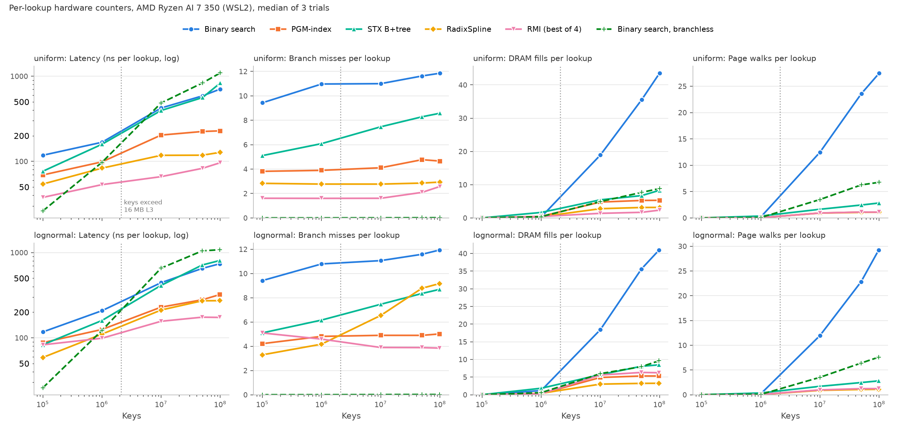
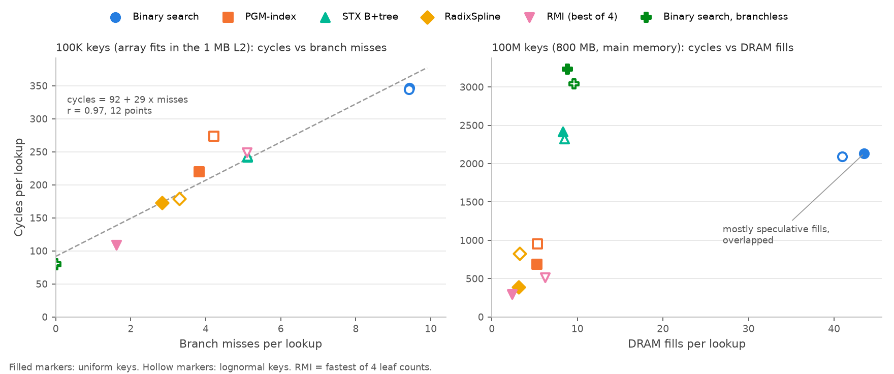
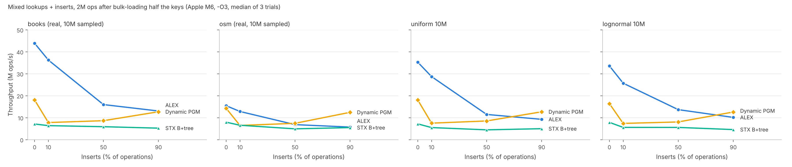
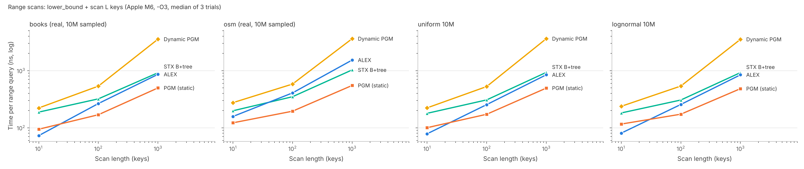
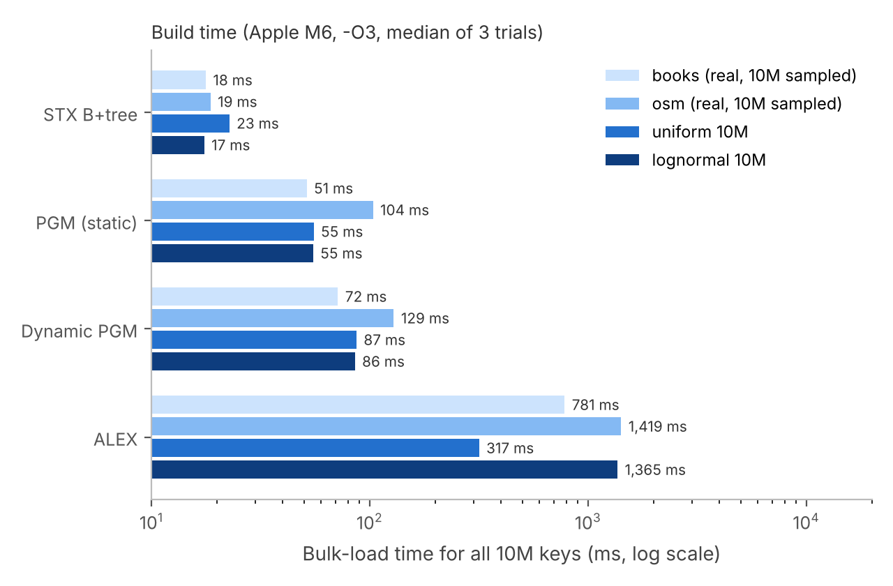
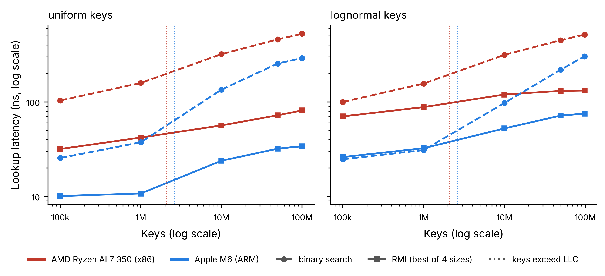

# Do Learned Indexes Still Win on Modern Hardware?

*CIS 4930 Final Project, Team 01: Riyon Praveen, Vishakha Tiwari, Sevara Badriddinova, Tuan Khang Phan*

> **Build note:** generated by `report/build_final_report.py`; edit the section files, not this file. Text marked [TODO] or [PLACEHOLDER] is not final.

## Introduction

Database systems rely on index structures to find data quickly. The two most widely used are B+trees, which answer both exact-match lookups and range queries, and hash tables, which answer exact-match lookups fast but cannot answer range queries. Both are general-purpose: they behave the same whatever the key distribution, and they make no use of patterns in the data.

Kraska et al. [1] proposed *learned indexes*, which replace the tree with a model of the mapping from each key to its position in a sorted array. A lookup predicts an approximate position, then searches a small window around the prediction. In their experiments, learned indexes were up to 70% faster than cache-optimized B+trees while using an order of magnitude less memory [1].

Those results were obtained on hardware that is now several years old. Modern processors have much larger caches and more varied architectures, x86 and ARM among them, and the cost of an index lookup depends heavily on how often it waits on main memory. It is therefore not clear that the reported advantages still hold. Learned indexes also have known weaknesses that headline lookup numbers do not show: data that is hard to model, insert-heavy workloads, range queries and build time.

**Goal.** This project asks *when and why learned indexes outperform traditional indexes on modern hardware*. We benchmark learned indexes (RMI [1], PGM-index [3], RadixSpline [4] and the updatable ALEX [5]) against a B+tree, a hash table and binary search, building on the SOSD benchmark [2]. Our five objectives are:

1. Compare lookup performance: average and 99th-percentile latency and throughput on four datasets.
2. Measure the trade-off between index memory and lookup speed.
3. Explain the results with hardware performance counters (cache misses, branch mispredictions, instructions per lookup).
4. Identify where learned indexes fall short: hard-to-model data, inserts, range queries and build time.
5. Assess the effect of modern hardware: repeat key experiments on different processor architectures, at sizes smaller and larger than the cache.

**Contributions so far.** [TODO (final assembly): add one line per objective once Objectives 1–3 are in.]
- **Objective 4.** On an Apple M6, the updatable learned index ALEX loses most of its lookup advantage over a B+tree on hard-to-model data (osm) and ties it at 90% inserts there. For long range scans and for bulk loading, it trails simpler structures.
- **Objective 5.** On both an AMD x86 laptop and an Apple ARM laptop, a learned index's advantage over binary search grows once the keys no longer fit in cache. At cache-resident sizes, whether it wins at all depends on the CPU.
- **Tooling.** Two ports to Apple Silicon (the SOSD benchmark and ALEX), seeded and checksummed datasets, and validation scripts that check every reported number against the raw logs.

## Related Work

*Draft for review by the Related Work owner (Riyon, per the task split). Descriptions are limited to what our proposal states and to properties we use directly in our experiments; check each against the paper before submission. All five references were verified to exist with the stated authors, venue and year (Crossref, Nov 25).*

**Learned indexes.**
- **RMI [1].** Kraska et al. introduced learned indexes and the Recursive Model Index (RMI). An RMI is a hierarchy of models: a top model routes a key to one of many simple second-stage models, which predict the key's position. A bounded "last-mile" search then corrects the prediction. Our quick benchmark (Objective 5) uses this two-stage linear form.
- **PGM-index [3].** Ferragina and Vinciguerra approximate the key-to-position mapping with piecewise linear segments whose prediction error is bounded by a parameter ε. They give provable worst-case bounds and a fully-dynamic variant that supports inserts. We use the static index (ε = 64) and the dynamic variant.
- **RadixSpline [4].** Kipf et al. build a learned index in a single pass over sorted data: a spline approximates the mapping, and a radix table over key prefixes finds the right spline segment. Its size is set by the number of radix bits and the spline error.
- **ALEX [5].** Ding et al. made learned indexes updatable. ALEX adapts its tree of models to the data and stores keys in gapped arrays, which leave room for inserts.

**Benchmarking.** Marcus et al. [2] built SOSD (Search On Sorted Data), an open benchmark for learned and traditional indexes on sorted 64-bit keys. It ships real datasets, including the four we planned to use (books, fb, osm and wiki), and tunable configurations for each index. Our lookup experiments build on SOSD. Our ARM64 port adds Apple Silicon support but compiles out several indexes (see Experimental Setup).

**How this project differs.** We repeat one common benchmark on laptops with different architectures (Objective 5). We also measure, in one shared driver, workloads beyond static lookups: inserts, range scans and build time (Objective 4). [TODO (Riyon): state how this differs from the hardware platforms and workloads covered in [1] and [2], checked against the papers.]

[TODO (Riyon): add any further related work, e.g. on learned-index robustness or hardware effects, with verified citations.]

## Experimental Setup

### Machines

| Machine | CPU and memory | Caches | OS and compiler | Used for |
|---|---|---|---|---|
| Apple MacBook Pro (Mac18,1) | Apple M6, ARM64; 12 cores (2 Super, 4 Performance, 6 Efficiency); 16 GB | L1d 128 KiB per P-core; L2 20 MiB per cluster; 128-byte cache lines (`sysctl`) | macOS 27.2.1; Apple clang 17.0.0 | Objectives 4 and 5; preliminary SOSD lookups |
| AMD laptop | AMD Ryzen AI 7 350, x86-64 | L3 16 MB | [TODO: OS, compiler, memory, power state] | Objective 5 |
| Intel laptop | [TODO] | [TODO] | [TODO] | Objective 5 |
| AMD laptop, Linux virtual machine | Same AMD Ryzen AI 7 350; 7 GiB visible to Linux | L1d 48 KiB and L2 1 MiB per core; L3 16 MiB (Linux `sysfs`) | Ubuntu 24.04.4 under WSL2 (Linux 6.6.87); g++ 13.3.0; AC power | Objective 3 (`perf_event_open`) |
| [TODO: machine(s) for Objectives 1–2] | [TODO] | [TODO] | [TODO] | Objectives 1–2 |

All measurements are single-threaded. macOS does not allow pinning a thread to a core, so the M6 runs are unpinned. The AMD run was pinned. Each table states whether its laptop was on AC or battery power.

### Indexes and software

- **SOSD [2], ported to ARM64.** We ported SOSD to Apple Silicon (fork branch `arm64-support` @ `28b078c` plus three patches in `sosd-arm64/patches/`), built with `-O3 -DNDEBUG -march=native`.
  - The port builds RadixSpline, PGM-index, the STX B+tree, RobinHash (hash table) and binary search.
  - RMI, ALEX, TS, CHT, ART and FAST depend on x86-only code and are compiled out.
- **Objective 4 driver** (`wp4/src/wp4_bench.cpp`). One C++ program runs ALEX [5], the STX B+tree 0.9, and the static and dynamic PGM-index [3] on identical operation sequences.
  - ALEX @ `4370da6` does not build on ARM, so we patch it with portable bit-counting builtins. Its own 42 unit tests pass on ARM64 with the patch.
  - PGM-index @ `c6fcf3d`.
- **learned-index-bench** (`learned-index-bench/bench.cpp`). A self-contained two-stage linear RMI [1] against binary search, run on each team member's laptop for Objective 5.
- **Objective 3 driver** (`wp3/src/wp3_perf.cpp`). Reads hardware counters around the lookup loop with `perf_event_open`, on the same keys and queries as learned-index-bench. It runs binary search (with and without a branch), the learned-index-bench RMI, PGM-index @ `c6fcf3d`, RadixSpline [4] @ `ab96aa5` and the STX B+tree 0.9 from SOSD. The events are listed in Objective 3.
- [TODO (Objectives 1-2 owners): list the SOSD build and index configurations used on x86, and how p99 and throughput were measured.]

### Datasets

| Dataset | Keys | Source | Used in |
|---|---|---|---|
| books | 800M in the file; 10M evenly spaced distinct keys used | SOSD [2]; MD5 checked against SOSD's published value | Objective 4 |
| osm (cell IDs) | 800M in the file; 10M evenly spaced distinct keys used | SOSD [2]; MD5 checked against SOSD's published value | Objective 4 |
| uniform | 10,000,000 | `wp4/src/gen_data.cpp`, seed 1; bit-identical across platforms | Objective 4 |
| lognormal(0, 2) | 9,980,950 | `wp4/src/gen_data.cpp`, seed 2 | Objective 4 |
| uniform and lognormal | 100K to 100M | generated inside `learned-index-bench` from a fixed seed | Objectives 3 and 5 |
| lognormal | 1M | an earlier script whose seed was not recorded; the keys are kept but cannot be regenerated | Preliminary SOSD lookups only |
| books, fb, osm, wiki (200M) | 200M each | SOSD [2] | [TODO: Objectives 1-2] |

### Methodology

- **Repeats.** Unless a section says otherwise, each reported number is the median of 3 trials. The benchmarks' inner repeats are described in each objective's method.
- **Validation.** Before analysis, scripts check every result row against its log. They also check the expected operation counts, and that all indexes return the same checksum for the same workload (`wp4/scripts/summarize_wp4.py`, `sosd-arm64/scripts/summarize_runs.py`, `wp3/scripts/summarize_wp3.py`).
- **Record keeping.** Each run folder records the machine description, compiler flags, power source and dataset checksums. Earlier runs are never overwritten.

## Objective 1: Lookup performance

> **[PLACEHOLDER: Objective 1 owner]** Add `report/objective1_<topic>.md` (start it with `# Objective 1: ...`) and rerun this script.
>
> Scope: Average and p99 lookup latency and throughput of RMI, PGM-index, RadixSpline, B+tree, hash table and binary search in SOSD on books, fb, osm and wiki (200M keys).
>
> Available input: preliminary ARM64 SOSD lookups on 1M lognormal keys (no p99; RMI not in the ARM64 port), `sosd-arm64/runs/20261125-100608-release/summary/lookup_default.csv`; see `sosd-arm64/FOR_TEAM.md`.

## Objective 2: Memory vs. speed

> **[PLACEHOLDER: Objective 2 owner]** Add `report/objective2_<topic>.md` (start it with `# Objective 2: ...`) and rerun this script.
>
> Scope: Lookup latency against index size for each index at several size settings on the four datasets; one plot per dataset, log-scale size axis.
>
> Available input: ARM64 latency-vs-size sweep for RadixSpline, PGM-index and B+tree on 1M lognormal keys, `sosd-arm64/runs/20261125-100608-release/summary/lookup_pareto.csv`; see `sosd-arm64/FOR_TEAM.md`.

## Objective 3: Hardware counters

*Draft. Every number comes from `wp3/runs/20261126-205955-ryzen-wsl/summary/wp3_summary.csv`, which `wp3/scripts/summarize_wp3.py` checked against the raw trial files (all checks pass). A copy of the summary and the figures is in `report/figures/objective3/`.*

### 3.1 Method

We measured, per lookup, where the time goes: instructions, branch misses, and where each cache miss was served from.

- **Machine.** The AMD Ryzen AI 7 350 laptop that produced the x86 results in Objective 5.
  - Ubuntu 24.04 under WSL2 (Linux 6.6, a Hyper-V virtual machine), 7 GiB visible to Linux.
  - g++ 13.3 with `-O3 -march=native -std=c++17 -DNDEBUG`. AC power, Windows "Balanced" power plan.
  - Caches reported by Linux: 48 KiB L1d and 1 MiB L2 per core, 16 MiB L3. Pages are 4 KiB; the benchmark does not request huge pages.
- **Counters.** The benchmark (`wp3/src/wp3_perf.cpp`) reads the counters itself with `perf_event_open`, around the lookup loop only. Key generation and index building are not counted, and only user-space events are counted.
  - Generic events: cycles, instructions, branches and branch misses.
  - AMD raw events from the processor manual: demand data-cache fills by source (event 0x43: from the L2, from the L3, from another core complex's cache, from DRAM), and L1 data-TLB misses (event 0x45), including those that also miss the L2 TLB and need a page walk.
  - The virtual machine exposes only the core's counters, not the L3's own counters. We therefore count last-level cache misses as demand fills from DRAM.
- **Workload.** The same keys and queries as Objective 5: uniform and lognormal(0, 2) keys at 100K, 1M, 10M, 50M and 100M keys, and 2M random lookups of existing keys. The key counts equal those of the Objective 5 Ryzen run at every size.
- **Indexes.** All return the position of the key in the sorted array.
  - Binary search: `std::lower_bound`, as in Objective 5.
  - Branchless binary search, as a control. It does the same comparisons, but the compiler turns the choice of half into a conditional move. It had 0.00 to 0.02 branch misses per lookup, which confirms this.
  - RMI [1]: the two-stage linear RMI of Objective 5, code copied unchanged, at the same 4 leaf counts. As in Objective 5, we report the fastest.
  - PGM-index [3] with ε = 64 (commit `c6fcf3d`, as in Objective 4).
  - RadixSpline [4] with 18 radix bits and maximum error 32, the library defaults (commit `ab96aa5`).
  - STX B+tree 0.9 with default node sizes (the copy shipped with SOSD).
  - Every index returned the same position as binary search for all 2M queries, at every size and in every trial.
- **Repeats.** For each dataset, size and index: 1 warm-up pass, then 5 passes for each of 3 event groups. Each group fits in the hardware counters, so no event was multiplexed (the kernel reported full counting time). A value is the median of the 5 passes, divided by 2M. The reported value is the median of 3 trials, each a separate run of the program.
- **Calibration.** Before the trials, a pointer chase tests the events inside the virtual machine. It follows a random cycle through memory of a known size, one dependent load per step. Table 3.1 shows that each size is served by the expected cache level. So the fill events can be read as "where the data came from".

**Table 3.1. Calibration: one dependent load per step, counts per load.**

| Memory touched | ns per load | Cycles | Fills from L2 | Fills from L3 | Fills from DRAM | Page walks |
|---|---:|---:|---:|---:|---:|---:|
| 32 KiB (fits L1) | 1.5 | 5 | 0.00 | 0.00 | 0.00 | 0.00 |
| 512 KiB (fits L2) | 5.8 | 19 | 0.99 | 0.01 | 0.00 | 0.00 |
| 4 MiB (fits L3) | 17.6 | 57 | 0.13 | 0.85 | 0.00 | 0.16 |
| 1 GiB (main memory) | 249 | 781 | 0.00 | 0.00 | 1.00 | 0.99 |

### 3.2 Results

**Table 3.2. 100K keys: the 0.8 MB array fits in the 1 MB L2. Per lookup. No index fetched more than 0.03 lines from DRAM.**

| Keys | Index | ns | Cycles | Instructions | Instructions per cycle | Branch misses | Fills from L2 | Fills from L3 |
|---|---|---:|---:|---:|---:|---:|---:|---:|
| uniform | Binary search (`std::lower_bound`) | 117.9 | 346 | 169 | 0.49 | 9.4 | 15.3 | 1.5 |
| uniform | Binary search, branchless | 26.1 | 79 | 151 | 1.90 | 0.0 | 5.3 | 0.4 |
| uniform | STX B+tree | 76.5 | 242 | 176 | 0.73 | 5.1 | 5.2 | 2.0 |
| uniform | PGM-index | 69.2 | 220 | 142 | 0.65 | 3.8 | 4.7 | 0.6 |
| uniform | RadixSpline | 54.1 | 173 | 122 | 0.70 | 2.8 | 2.8 | 1.6 |
| uniform | RMI (1,562 leaves) | 37.7 | 109 | 73 | 0.67 | 1.6 | 1.8 | 0.4 |
| lognormal | Binary search (`std::lower_bound`) | 117.2 | 344 | 169 | 0.49 | 9.4 | 15.7 | 1.2 |
| lognormal | Binary search, branchless | 25.9 | 81 | 151 | 1.87 | 0.0 | 5.3 | 0.4 |
| lognormal | STX B+tree | 83.0 | 243 | 176 | 0.72 | 5.1 | 5.0 | 2.1 |
| lognormal | PGM-index | 87.8 | 273 | 188 | 0.69 | 4.2 | 4.8 | 0.9 |
| lognormal | RadixSpline | 58.8 | 179 | 126 | 0.70 | 3.3 | 2.9 | 0.7 |
| lognormal | RMI (1,562 leaves) | 82.8 | 249 | 123 | 0.49 | 5.1 | 10.6 | 1.1 |

**Table 3.3. 100M keys: the 800 MB array is in main memory. Per lookup. The last column divides latency by DRAM fills.**

| Keys | Index | ns | Instructions | Branch misses | Fills from L3 | Fills from DRAM | Page walks | ns per DRAM fill |
|---|---|---:|---:|---:|---:|---:|---:|---:|
| uniform | Binary search (`std::lower_bound`) | 707 | 263 | 11.9 | 11.7 | 43.5 | 27.5 | 16 |
| uniform | Binary search, branchless | 1,094 | 231 | 0.0 | 4.6 | 8.8 | 6.8 | 124 |
| uniform | STX B+tree | 832 | 277 | 8.6 | 4.1 | 8.3 | 2.8 | 100 |
| uniform | PGM-index | 228 | 195 | 4.7 | 0.2 | 5.3 | 1.1 | 43 |
| uniform | RadixSpline | 128 | 123 | 2.9 | 2.1 | 3.2 | 1.1 | 40 |
| uniform | RMI (97,656 leaves) | 96 | 91 | 2.6 | 1.1 | 2.3 | 1.1 | 41 |
| lognormal | Binary search (`std::lower_bound`) | 740 | 263 | 11.9 | 11.7 | 41.0 | 29.2 | 18 |
| lognormal | Binary search, branchless | 1,081 | 231 | 0.0 | 4.2 | 9.6 | 7.6 | 112 |
| lognormal | STX B+tree | 807 | 277 | 8.7 | 3.8 | 8.5 | 2.8 | 95 |
| lognormal | PGM-index | 321 | 239 | 5.0 | 0.2 | 5.3 | 1.1 | 61 |
| lognormal | RadixSpline | 273 | 275 | 9.2 | 6.2 | 3.3 | 1.1 | 84 |
| lognormal | RMI (1,533,381 leaves) | 174 | 104 | 3.8 | 0.6 | 6.2 | 1.2 | 28 |

**Figure 3.1.** Latency, branch misses, DRAM fills and page walks per lookup against key count. The dotted line marks where the keys exceed the 16 MB L3. "RMI" is the fastest of 4 leaf counts.

**Figure 3.2.** Cycles per lookup against branch misses at 100K keys (left, with a least-squares line), and against DRAM fills at 100M keys (right).

### 3.3 Findings

1. **In cache, branch misses set the cost, not cache misses.**
   - At 100K keys no index goes to main memory. Across the six indexes and two datasets, cycles per lookup follow branch misses closely: cycles ≈ 92 + 29 × branch misses (r = 0.97, 12 points; Figure 3.2, left).
   - `std::lower_bound` mispredicts 9.4 of its 17 comparisons per lookup, about half, as expected for random keys.
   - The branchless binary search makes the same comparisons without mispredicting and is 4.5× faster (26 vs 118 ns). The difference, (346 - 79) / 9.4, is about 28 cycles per branch miss.
   - At 100K keys the branchless search is the fastest index, ahead of the best RMI on both datasets (26 vs 38 ns on uniform keys, 26 vs 83 ns on lognormal keys).
   - So, on this CPU, the RMI's in-cache win over binary search in Objective 5 (3.3× uniform, 1.4× lognormal at 100K keys) is mostly a win over branch misses. Writing binary search without the branch removes it.
   - This holds only while the array fits in the L2. At 1M keys (8 MB, in the L3), the RMI is again the fastest: 53 vs 97 ns on uniform keys and 99 vs 122 ns on lognormal keys against the branchless search.
2. **Out of cache, the number of dependent memory accesses sets the cost.**
   - At 100M keys, the learned indexes fetch the fewest lines from DRAM: 2.3 to 6.2 per lookup for the RMI, 3.2 to 3.3 for RadixSpline, 5.3 for PGM. Each needs about one page walk. The B+tree fetches 8.3 to 8.5 lines and needs 2.8 page walks.
   - The branchless binary search fetches 8.8 to 9.6 lines from DRAM, roughly the last 9 of its 27 levels. Each load depends on the previous comparison, so the loads cannot overlap. It is the slowest index (1,081 to 1,094 ns, 112 to 124 ns per fill).
   - `std::lower_bound` fetches 41 to 44 lines and needs 27 to 29 page walks per lookup, yet it is 1.5× faster than the branchless version (707 vs 1,094 ns on uniform keys). It guesses each comparison and loads ahead along the guessed path. Most of these loads are discarded, but the correct ones arrive early, so the extra DRAM traffic costs little time (16 to 18 ns per fill). Removing the branch helps in cache and hurts in main memory.
   - So the number of DRAM fills alone does not predict latency (Figure 3.2, right). What matters is how many misses each lookup must wait for one after another. The learned indexes pay 28 to 61 ns per DRAM fill (RadixSpline on lognormal keys, 84 ns). The B+tree pays 95 to 100 ns, because each node's address is known only after the previous node arrives.
   - This supports the explanation proposed in Objective 5: a model replaces a chain of about 9 dependent misses with a prediction and a short search in one place. At 100M keys the RMI is 8.6× faster than the B+tree on uniform keys (96 vs 832 ns) and 4.7× faster on lognormal keys (174 vs 807 ns).
3. **A less accurate model turns into more memory traffic.**
   - On 100M lognormal keys, the RMI's DRAM fills grow with its last-mile search window. With 1.5M leaves (37 MB), the window averages 2^6.6 keys, and a lookup takes 6.2 DRAM fills and 174 ns. With 24K leaves (0.6 MB), the window averages 2^11.9 keys, and a lookup takes 32.9 fills and 437 ns. (Window sizes are the `avg_log2_err` column of the Objective 5 CSV, same keys and code.)
   - On uniform keys the model stays accurate at every setting (windows of 2^3.2 to 2^6.2 keys, 2.1 to 3.5 DRAM fills at 100M keys).
   - For Objective 2, this is the memory-for-speed trade inside a single learned index: more leaves cost memory and save DRAM fills.
   - RadixSpline on lognormal keys pays differently: few DRAM fills (3.3) but 9.2 branch misses and 275 instructions per lookup at 100M keys, against 2.9 and 123 on uniform keys. This fits a longer search among spline points where the skewed keys crowd a few radix buckets. We did not instrument the library to confirm this.

**Open question for Objective 5.** The M6's in-cache binary search (25.5 and 24.7 ns at 100K keys) runs at the speed of our branchless search on the Ryzen (26.1 and 25.9 ns), not of `std::lower_bound` (117 to 118 ns). One possible cause is that Apple clang compiles `std::lower_bound` without a branch on ARM64. If so, part of the M6's in-cache lead, and the RMI's loss there, comes from the compiled code rather than the hardware alone. We have not checked this. The check is to disassemble the M6 build of `learned-index-bench` (`otool -tv bench`) and look for a conditional select (`csel`) in the search loop.

### 3.4 Limitations

- **A virtual machine, not native Linux.** WSL2 runs Linux in a Hyper-V virtual machine.
  - The calibration (Table 3.1) shows that the core's counters work correctly inside it.
  - Pinning fixes the virtual CPU, but Windows may still move it between physical cores during a run.
  - Page walks in a virtual machine go through two sets of page tables, so they cost more than on native Linux.
  - Latencies here are 1.06× to 1.45× those of the native Windows run in Objective 5. The gap is largest for binary search at 10M keys and above (1.28× to 1.45×, where it does 12 to 29 page walks per lookup) and smaller for the RMI (1.15× to 1.34×). Counts of instructions, branch misses and fills do not depend on this.
- **Clock speed was not fixed.** Cycles divided by time give 2.7 to 3.3 GHz across the run. The three trials differ in latency by a median of 1.18× (worst row 2.5×). The counts are far more stable: instructions are identical in every trial, branch misses differ by at most 4%, and DRAM fills by a median of 7%. Our conclusions rest on the counts and on latency gaps of 1.5× or more.
- **No direct L3 counter.** We count last-level misses as demand fills from DRAM. These exclude hardware prefetches and include loads on wrongly guessed paths. That is why `std::lower_bound` shows more DRAM fills than it has levels.
- **Scope.** One CPU (macOS has no access to these counters, and the Intel laptop was not measured). Synthetic keys only, up to 100M keys: the four 200M-key SOSD datasets are not on this laptop, and we estimate that building the B+tree over 200M keys would exceed the 7 GiB the virtual machine has. No hash table.
- **Independent lookups.** As in Objective 5, consecutive lookups do not depend on each other, so the core can overlap one lookup's misses with the next one's. A workload where each lookup depends on the previous result would pay more per miss.

## Objective 4: Where learned indexes fall short

*Every number comes from `wp4/runs/20261125-111310-m6/summary/wp4_summary.csv`, which `wp4/scripts/summarize_wp4.py` checked against the raw logs. An earlier run (`20261125-104356-m6`, on battery, synthetic data only) replicates the synthetic results; see 4.1.*

### 4.1 Method

Lookup benchmarks such as SOSD study read-only, static data. We asked what happens to a learned index when the data changes, when queries ask for ranges instead of single keys, when the index must first be built, and when the keys are hard to model. We compared one updatable learned index, ALEX [5], against a conventional STX B+tree. We also compared it against PGM-index [3] in two forms: the static `PGMIndex` (ε = 64) over a sorted array, and the updatable `DynamicPGMIndex`. All four ran inside one C++ driver (`wp4/src/wp4_bench.cpp`) on identical, pre-generated operation sequences.

- **Mixed workload.** Bulk-load a random half of the keys, then run 2,000,000 operations, of which 0%, 10%, 50% or 90% are inserts. Inserts take new keys from the unloaded half in random order. The remaining operations are point lookups of loaded keys.
- **Range scans.** Find the first key ≥ a start key drawn from the data, then sum the payloads of the next L = 10, 100 or 1000 keys. This uses 200K queries for L = 10 and 100, and 20K for L = 1000.
- **Build time.** Bulk-load all keys from a sorted array.

**Correctness.** Every index returns a checksum of the payloads it read. For every workload, dataset and trial, all indexes returned identical checksums, so they did the same work.

**Data.** We used four 10M-key datasets:

- **Real data from SOSD [ref].**
  - `books_800M_uint64` (Amazon book popularity), which is easy to model.
  - `osm_cellids_800M_uint64` (OpenStreetMap cell IDs), which is hard to model.
  - Both files were downloaded from Harvard Dataverse, and their MD5s match the values SOSD publishes.
  - The driver sorts and de-duplicates each file, then keeps 10,000,000 evenly spaced distinct keys (a fixed stride, so the sample is deterministic). Their sha256s are `ef35edc5…` (books) and `334f0055…` (osm).
- **Synthetic data from `wp4/src/gen_data.cpp`.**
  - Uniform 50-bit keys (seed 1, 10,000,000 unique). This file is bit-identical across platforms.
  - Lognormal(0, 2) × 10⁹ (seed 2, 9,980,950 unique). This file differs between macOS and Linux in 3 of 9,980,950 keys, each by 1, because their math libraries round differently.

The sha256 of every input file is recorded with the run.

**Platform.**
- Hardware: Apple M6 MacBook Pro (Mac18,1, 16 GB, 20 MB L2 per CPU cluster per `sysctl`).
- Software: macOS 27.2.1, Apple clang 17, `-O3 -mcpu=native`, single thread.
- Each number is the median of 3 trials.
- The laptop was on AC power. macOS does not allow pinning a thread to a core.

**Replication.** We had already run the same synthetic workloads on battery power. Across the 56 synthetic-data results present in both runs, the median difference between runs is 3.4%. 49 of 56 differ by at most 10%, and the largest difference is 22.9% (B+tree, uniform, 50% inserts). Every conclusion below holds in both runs.

**Porting ALEX.** ALEX does not build on ARM: it uses x86 bit-counting intrinsics and the `cpuid` instruction. We replaced them with portable compiler builtins that have the same semantics (`wp4/patches/alex-0001-…`). ALEX's own unit test suite passes on ARM64 with the patch: 42/42 test cases, 42,490 assertions.

### 4.2 Results

**Table 4.1. Mixed lookups and inserts, throughput in million operations per second (higher is better).** Best per row in bold.

| Dataset | Inserts | ALEX | B+tree | Dynamic PGM |
|---|---:|---:|---:|---:|
| books | 0% | **43.8** | 7.1 | 18.1 |
| books | 10% | **36.2** | 6.4 | 7.8 |
| books | 50% | **16.0** | 5.9 | 8.6 |
| books | 90% | **13.0** | 5.2 | 12.7 |
| osm | 0% | **15.4** | 8.0 | 14.2 |
| osm | 10% | **12.8** | 6.6 | 6.5 |
| osm | 50% | 6.9 | 4.9 | **7.4** |
| osm | 90% | 5.7 | 5.5 | **12.4** |
| uniform | 0% | **35.2** | 7.2 | 18.0 |
| uniform | 10% | **28.7** | 5.5 | 7.5 |
| uniform | 50% | **11.5** | 4.5 | 8.5 |
| uniform | 90% | 9.2 | 5.0 | **12.7** |
| lognormal | 0% | **33.6** | 7.9 | 16.4 |
| lognormal | 10% | **25.7** | 5.6 | 7.4 |
| lognormal | 50% | **13.7** | 5.6 | 8.1 |
| lognormal | 90% | 10.1 | 4.6 | **12.6** |

**Table 4.2. Range scans, nanoseconds per query (lower is better).** Best per row in bold.

| Dataset | Scan length | ALEX | B+tree | PGM (static) | Dynamic PGM |
|---|---:|---:|---:|---:|---:|
| books | 10 | **73** | 188 | 94 | 222 |
| books | 100 | 265 | 320 | **169** | 535 |
| books | 1000 | 861 | 917 | **498** | 3,546 |
| osm | 10 | 158 | 198 | **122** | 275 |
| osm | 100 | 407 | 349 | **195** | 582 |
| osm | 1000 | 1,529 | 1,028 | **550** | 3,615 |
| uniform | 10 | **78** | 179 | 100 | 223 |
| uniform | 100 | 254 | 307 | **172** | 526 |
| uniform | 1000 | 845 | 931 | **495** | 3,617 |
| lognormal | 10 | **81** | 182 | 116 | 237 |
| lognormal | 100 | 256 | 306 | **173** | 537 |
| lognormal | 1000 | 844 | 922 | **483** | 3,526 |

**Table 4.3. Bulk-load time for all 10M keys, milliseconds (lower is better).**

| Dataset | B+tree | PGM (static) | Dynamic PGM | ALEX | ALEX ÷ B+tree |
|---|---:|---:|---:|---:|---:|
| books | **18** | 51 | 72 | 781 | 44× |
| osm | **19** | 104 | 129 | 1,419 | 76× |
| uniform | **23** | 55 | 87 | 317 | 14× |
| lognormal | **17** | 55 | 86 | 1,365 | 78× |

**Figure 4.1.** Throughput of mixed lookups and inserts versus insert fraction, per dataset (data of Table 4.1).

**Figure 4.2.** Time per range query versus scan length, log–log (data of Table 4.2).

**Figure 4.3.** Bulk-load time for all 10M keys, log scale (data of Table 4.3).

### 4.3 Findings

1. **Hard-to-model data takes away most of ALEX's lookup advantage.**
   - With no inserts, ALEX reaches 43.8 M ops/s on books but only 15.4 on osm, 2.8× lower. The B+tree is not slower on osm (8.0 vs 7.1 M ops/s).
   - ALEX's lead over the B+tree therefore shrinks from 6.2× on books to 1.9× on osm.
   - osm is also the one dataset where ALEX loses range scans to the B+tree: at L = 100 (407 vs 349 ns) and at L = 1000 (1,529 vs 1,028 ns, 1.5× slower).
   - The SOSD lookup results already showed osm to be the hard case for learned indexes. WP4 shows that the same holds for an updatable learned index, and for scans as well as point lookups.
2. **Inserts erode ALEX's lead over the B+tree.**
   - ALEX's own throughput falls 2.7–3.8× from read-only to 90% inserts.
   - Its lead over the B+tree shrinks from 4.3–6.2× at 0% inserts to 1.9–2.5× at 90% on books, uniform and lognormal.
   - On osm the two effects combine, and at 90% inserts ALEX and the B+tree are effectively tied (5.7 vs 5.5 M ops/s, 1.04×).
   - This is consistent with the node expansions and retraining that inserts trigger in ALEX's design [5]. We did not instrument these internals.
3. **At insert-heavy mixes, a different learned design wins.**
   - At 90% inserts, Dynamic PGM is faster than ALEX on osm (2.2×), uniform (1.4×) and lognormal (1.2×), and ties it on books (12.7 vs 13.0 M ops/s).
   - Its log-structured levels absorb inserts cheaply, and its 90%-insert throughput is nearly the same on every dataset (12.4–12.7 M ops/s).
   - At 10% inserts it is among the slowest indexes (6.5–7.8 M ops/s).
   - No single index is best across the whole range.
4. **Learned models help find the first key, not scan the rest.**
   - On books, uniform and lognormal, ALEX answers L = 10 scans fastest, 2.3–2.6× faster than the B+tree.
   - As scans get longer, finding the start matters less and the scan itself dominates. At L = 1000, ALEX is only 1.07–1.10× faster than the B+tree on those datasets.
   - A static PGM over a plain sorted array is then 1.7× faster than ALEX, and 2.8× faster on osm. This is consistent with ALEX's gapped leaf arrays, which reserve empty slots for future inserts that a scan must skip.
   - Dynamic PGM is 6.6–7.3× slower than static PGM at L = 1000, because its iterator must merge several sorted levels.
5. **Build time is ALEX's clearest weakness, and it depends on the data.**
   - ALEX takes 14× longer to bulk-load than the B+tree on uniform keys, 44× on books, and 76–78× on osm and lognormal (1,419 vs 19 ms on osm).
   - Going from books to osm makes ALEX's build 1.8× slower, as it does for both PGM variants (2.0× static, 1.8× dynamic). The B+tree barely changes (1.05×).
   - Build cost and lookup difficulty are separate signals. Lognormal keys make ALEX's build as slow as osm does, yet ALEX's read-only lookups on lognormal (33.6 M ops/s) are close to uniform (35.2), not osm (15.4).

## Objective 5: Do learned indexes win on every CPU?

*Draft. Every number comes from `learned-index-bench/results/*.csv`, summarized by `learned-index-bench/compare_cpus.py` into `report/figures/objective5/wp5_summary.csv`. Two CPUs so far; an Intel laptop is still missing (see 5.4).*

### 5.1 Method

Every teammate runs the same benchmark, `learned-index-bench/bench.cpp`, on their own laptop. It compares a two-stage linear RMI (Kraska et al.) with plain binary search over sorted 64-bit keys.

- **Datasets.** Uniform and lognormal(0, 2) keys at five sizes, from 100K to 100M keys.
  - The keys are generated in the benchmark from a fixed seed and de-duplicated.
  - The key counts match across machines to within 2 keys (out of up to 100M).
- **Measurement.** Each result is the median of 5 runs, after 1 warm-up run. Each run is 2M random lookups of existing keys.
- **RMI settings.** The RMI is tried at 4 leaf counts. We report the fastest per size.

| | AMD Ryzen AI 7 350 | Apple M6 |
|---|---|---|
| Architecture | x86-64 | ARM64 |
| Last-level cache | 16 MB L3 (from the benchmark README) | 20 MB L2 per CPU cluster (`sysctl`) |
| Compiler and flags | not recorded | Apple clang 17, `-O3 -mcpu=native` |
| Thread pinning | pinned (`--pin`) | not possible on macOS |
| Power | not recorded | battery |

The 8-byte keys alone fill the last-level cache at about 2.1M keys on the Ryzen and 2.6M keys on the M6. The dotted lines in the figures mark these points.

### 5.2 Results

**Table 5.1. Median lookup latency in ns. "RMI" is the fastest of 4 leaf counts. Speedup = binary search ÷ RMI.**

| Keys | Ryzen binary search | Ryzen RMI | Ryzen speedup | M6 binary search | M6 RMI | M6 speedup |
|---|---:|---:|---:|---:|---:|---:|
| uniform 100K | 103.4 | 31.7 | 3.3× | 25.5 | 10.1 | 2.5× |
| uniform 1M | 158.6 | 41.9 | 3.8× | 37.4 | 10.7 | 3.5× |
| uniform 10M | 320.1 | 56.3 | 5.7× | 134.9 | 23.8 | 5.7× |
| uniform 50M | 458.8 | 72.2 | 6.4× | 254.8 | 32.0 | 8.0× |
| uniform 100M | 525.5 | 81.1 | 6.5× | 290.8 | 33.9 | 8.6× |
| lognormal 100K | 99.9 | 70.2 | 1.4× | 24.7 | 26.1 | **0.95×** |
| lognormal 1M | 156.0 | 88.0 | 1.8× | 30.9 | 32.3 | **0.95×** |
| lognormal 10M | 314.5 | 119.7 | 2.6× | 97.2 | 52.3 | 1.9× |
| lognormal 50M | 449.1 | 130.8 | 3.4× | 218.7 | 71.6 | 3.1× |
| lognormal 100M | 514.8 | 131.8 | 3.9× | 303.8 | 75.3 | 4.0× |

**Figure 5.1.** Lookup latency against key count on each CPU, log–log. Dashed lines are binary search; solid lines are the fastest RMI setting. Dotted vertical lines mark where the keys exceed each CPU's last-level cache.

**Figure 5.2.** RMI speedup over binary search on each CPU. Above 1, the learned index is faster.

### 5.3 Findings

1. **The M6 is faster for both methods, by most when the data fits in cache.**
   - For binary search, the M6 is 4.0–5.1× faster than the Ryzen up to 1M keys. At 100M keys it is only 1.7–1.8× faster.
   - For the RMI, the M6 is 2.7–3.9× faster up to 1M keys, and 1.8–2.4× faster at 100M.
   - The gap shrinks once lookups have to go to main memory. This fits main-memory latency, not core speed, setting the cost at large sizes; we did not measure memory latency directly (Objective 3).
2. **On both CPUs, the learned index wins more as the data grows.**
   - The RMI's speedup over binary search climbs past the cache limit on both machines.
   - Uniform keys: the speedup rises from 3.3× to 6.5× on the Ryzen and from 2.5× to 8.6× on the M6.
   - Lognormal keys: it rises from 1.4× to 3.9× on the Ryzen and from 0.95× to 4.0× on the M6.
   - This matches the project's premise: a learned model saves the most when each binary-search step is a cache miss.
3. **Whether the learned index wins at small sizes depends on the CPU.**
   - With lognormal keys at 100K and 1M, the RMI is 5% slower than binary search on the M6 (26.1 vs 24.7 ns and 32.3 vs 30.9 ns). On the Ryzen it is still 1.4–1.8× faster.
   - Here the RMI's model is inaccurate: its last-mile search window averages 2^7–2^9 keys (the `avg_log2_err` column). Meanwhile, binary search over cache-resident keys is very fast on the M6.
   - So a hardware change alone can turn a learned-index win into a loss. "Learned indexes beat binary search" holds on these laptops only once the keys exceed the cache, or when the model is accurate (uniform keys).
4. **At large sizes, the learned index benefits more from the M6 than binary search does.**
   - At 100M uniform keys, the RMI is 2.4× faster on the M6 than on the Ryzen, while binary search is only 1.8× faster. So the RMI's speedup over binary search is higher on the M6 (8.6× vs 6.5×).
   - One explanation is that the RMI makes few, independent memory accesses, which a wide out-of-order core can overlap. We have no counter data to confirm this.

### 5.4 Limitations

- **Two CPUs, one per architecture.** The task plan asked for AMD, Intel and ARM. No Intel CSV has been pushed yet. To add one, `compare_cpus.py` takes another `"label|color|LLC bytes|csv"` argument.
- **Run conditions differ and are partly unrecorded.**
  - The Ryzen run was pinned. The M6 run was unpinned and on battery.
  - The Ryzen's operating system, compiler and power state are not recorded in the repository.
  - The Ryzen's own repeat runs show how much this matters. Unpinned, it was 8.5% slower on the median row and up to 1.59× slower; without the warm-up run, up to 1.41× slower on one row.
  - Cross-CPU ratios under about 1.5× should therefore be read with care. The 4–5× cache-resident gap and the speedup trends are far larger than this noise.
- **Noisy rows on the M6.** In 9 of 50 M6 rows, the slowest run was more than 1.2× the median. In one row it was 2.8× (an RMI setting at 100M uniform keys that is not the fastest one, so it is not in Table 5.1). Medians are robust to this, but the run should be repeated on AC power.
- **Synthetic data, one learned index.** learned-index-bench covers only RMI against binary search, on uniform and lognormal keys. Objectives 1 and 2 cover the other indexes and the real SOSD datasets.

## Limitations

- **One machine, light statistics.**
  - All WP4 and ARM64 results come from one Apple M6 laptop with no thread pinning, using medians of 3 trials.
  - 71% of results have their slowest trial within 10% of the median. Individual trials sometimes spiked: up to 2.1× the median for timed operations (one B+tree scan trial), and 1.3× for builds.
  - Differences under about 10% should not be read as significant.
- **Real datasets are sampled.**
  - books and osm were reduced from 800M keys to 10M evenly spaced distinct keys, to match the synthetic sets and the laptop's 16 GB of memory.
  - Sampling preserves the shape of the key distribution but makes it coarser. At 800M keys, the indexes would also be much larger than the 20 MB L2 cache, so absolute numbers would differ.
- **Limited workload shapes.**
  - Inserts are random keys drawn from the same dataset as the loaded keys. We did not test sequential or append-only inserts, distribution shift, or deletes, which are known stress cases for learned indexes.
  - Range start keys always exist in the data.
- **Default configurations.**
  - The STX B+tree, ALEX and Dynamic PGM ran with library defaults, and static PGM used ε = 64. We did not tune node sizes, so a tuned B+tree could narrow the gaps.
  - Memory footprint was not measured in WP4 (see Objective 2).
- **The ARM64 SOSD port is partial.** RMI, ALEX, TS, CHT, ART and FAST are compiled out of SOSD on Apple Silicon. ALEX was therefore benchmarked in our own driver rather than in SOSD, and its numbers are not directly comparable with the SOSD lookup tables.
- **No hardware counters.** `perf` requires native Linux, so these results are not broken down into cache misses or branch mispredictions (Objective 3).
- **One dataset cannot be regenerated.** The 1M-key lognormal dataset behind the earlier SOSD ARM64 results was produced by a script whose seed and parameters were not recorded. Its keys are preserved, but it cannot be regenerated. All WP4 data is either seeded or checksummed.

## Conclusion

*Draft. It covers the objectives with verified results (3, 4 and 5); [TODO (final assembly)] add the conclusions of Objectives 1-2 and revise the overall answer.*

We asked when and why learned indexes beat traditional indexes on modern hardware. The results so far give a conditional answer.

**When they win.**
- On both an x86 and an ARM laptop, a learned index (RMI) beats binary search by more as the data grows past the cache. At 100M uniform keys it is 6.5× faster on the AMD Ryzen and 8.6× faster on the Apple M6 (Objective 5).
- For read-mostly point lookups on data that is easy to model, the updatable ALEX is 4.3–6.2× faster than a B+tree at 10M keys (books, uniform and lognormal; Objective 4).

**When they do not.**
- On data that is hard to model (osm), ALEX's read-only lead over the B+tree drops to 1.9×, and at 90% inserts the two tie.
- On the M6, with cache-resident lognormal keys, the RMI is 5% slower than plain binary search, while on the AMD laptop it still wins. The same index and data can win or lose depending on the processor.
- When the keys fit in the L2 cache, a binary search written without a branch beats every index we measured on the AMD laptop, including the best RMI (26 vs 38 ns at 100K uniform keys; Objective 3).
- Long range scans favour a static PGM-index over ALEX (1.7–2.8× faster at 1000 keys).
- Bulk loading ALEX takes 14–78× longer than a B+tree.
- Under insert-heavy mixes, a different learned design (the dynamic PGM-index) is faster than ALEX on three of four datasets.

**Why.** Our measurements are consistent with lookup cost being set by cache misses once the keys exceed the cache. There, a learned model saves the most, because it replaces many dependent memory accesses with a prediction and a short search. Within the cache, fast binary search on a modern core narrows or erases that saving. Hardware counters on the AMD laptop support this, with one refinement (Objective 3). At 100M keys the learned indexes fetch 2 to 6 lines from DRAM per lookup and walk the page table about once. A B+tree or a branchless binary search waits for 8 to 10 dependent fetches, and is 2.5 to 11 times slower than the learned indexes. What counts is the number of fetches a lookup must wait for in sequence, not the total: `std::lower_bound` fetches over 40 lines, mostly on paths it guesses and then discards, and is still faster than the branchless version. Within the cache, branch misses set the cost (about 29 cycles each), so the learned index's in-cache lead over `std::lower_bound` is largely a lead over branch misses.

**Does [1] still hold?** In part. The core claim, that a learned model can beat a general-purpose index on lookups, holds on both laptops once the data exceeds the cache. But the size of the win depends on the processor, the key distribution and the workload, and the costs of inserts, range scans and build time are real. [TODO (Objectives 1–2): add the lookup and memory comparison on the four SOSD datasets, including whether learned indexes still use an order of magnitude less memory than B+trees at equal speed.]

**Future work.** Sequential and append-only inserts, deletes, full-size (200M–800M key) runs, and an Intel data point for the CPU comparison.

## References

[1] T. Kraska, A. Beutel, E. H. Chi, J. Dean, and N. Polyzotis. "The Case for Learned Index Structures." SIGMOD, 2018. doi:10.1145/3183713.3196909

[2] R. Marcus, A. Kipf, A. van Renen, M. Stoian, S. Misra, A. Kemper, T. Neumann, and T. Kraska. "Benchmarking Learned Indexes." PVLDB 14(1), 2020. doi:10.14778/3421424.3421425

[3] P. Ferragina and G. Vinciguerra. "The PGM-index: A Fully-Dynamic Compressed Learned Index with Provable Worst-Case Bounds." PVLDB 13(8), 2020. doi:10.14778/3389133.3389135

[4] A. Kipf, R. Marcus, A. van Renen, M. Stoian, A. Kemper, T. Kraska, and T. Neumann. "RadixSpline: A Single-Pass Learned Index." aiDM Workshop at SIGMOD, 2020. doi:10.1145/3401071.3401659

[5] J. Ding, U. F. Minhas, J. Yu, C. Wang, J. Do, Y. Li, H. Zhang, B. Chandramouli, J. Gehrke, D. Kossmann, D. Lomet, and T. Kraska. "ALEX: An Updatable Adaptive Learned Index." SIGMOD, 2020. doi:10.1145/3318464.3389711

*All five DOIs resolved on Crossref to the titles, first authors, venues and years above, with no retraction or correction notice recorded (checked Nov 25, 2026).*
