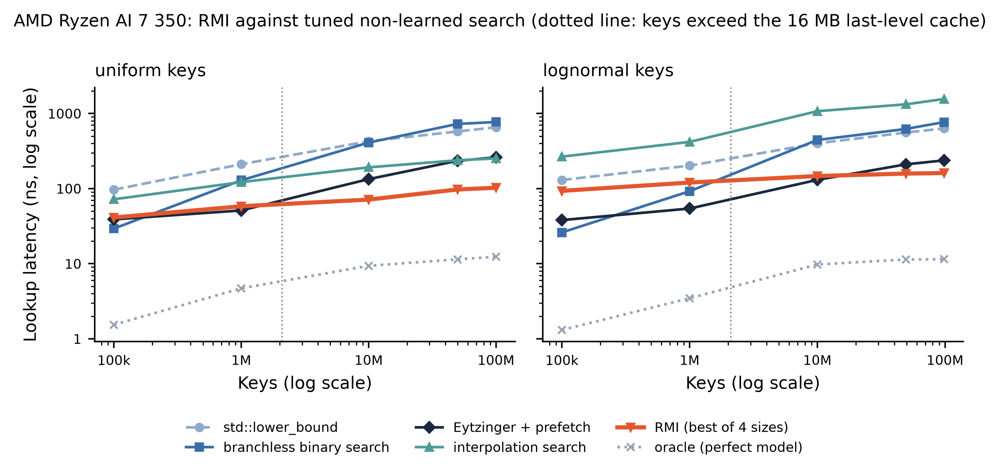

# Objective 1: Is a learned index faster than a tuned non-learned search?

*Every number comes from `learned-index-bench/results/ryzen_ai7_350_x86_baselines.csv`, summarized by `learned-index-bench/baselines.py` into `report/figures/objective1/baselines_summary.csv`. This file covers synthetic keys. The four 200M-key SOSD datasets, with p99, throughput and index size, are in `wp12/README.md` and in Sections 5 and 7 of the final report.*

A learned index is usually compared with `std::lower_bound`, the default binary search. That is not a fair bar: a non-learned search can be tuned too. Here we compare the RMI with the fastest of four non-learned searches, and with an oracle that knows each key's position.

## 1.1 Method

We extended `learned-index-bench` (the benchmark of Objective 5) with a `--baselines` option. It uses the same keys, the same 2M queries and the same timing as the RMI rows: median of 5 runs after a warm-up, single thread, pinned.

- **std::lower_bound**: the default binary search.
- **Branchless binary search**: each step picks a half with a conditional move, so no branch is mispredicted (Objective 3 showed that branch misses dominate in cache).
- **Eytzinger layout with prefetching** [6]: the keys stored in breadth-first tree order, so the next levels can be prefetched. It needs a second copy of the keys (800 MB at 100M keys).
- **Interpolation search**: up to 8 probes along a straight line between the end keys of the current range, then binary search. It is a "model" with two points and no training.
- **Oracle**: the true position is given, and the lookup only reads that key. No index can do less, so it is the floor.

Every search is checked against `std::lower_bound` on 20,000 queries before it is timed. The run was on the AMD Ryzen AI 7 350 (Windows 11, MinGW g++ 16.1, `-O3 -march=native`, AC power; `results/ryzen_ai7_350_x86_baselines_machine.txt`).

## 1.2 Results

**Table 1.1. Median lookup latency in ns. RMI = fastest of 4 leaf counts. The last two columns are the RMI's speedup over `std::lower_bound` and over the fastest non-learned search; below 1, the RMI loses.**

| Keys | std::lower_bound | Branchless | Eytzinger | Interpolation | RMI | Oracle | vs default | vs best non-learned |
|---|---:|---:|---:|---:|---:|---:|---:|---:|
| uniform 100K | 96.6 | **29.4** | 38.9 | 72.1 | 41.2 | 1.5 | 2.3× | **0.71×** |
| uniform 1M | 211.3 | 129.1 | **51.2** | 122.1 | 58.2 | 4.7 | 3.6× | **0.88×** |
| uniform 10M | 426.9 | 410.1 | 133.7 | 191.8 | **71.4** | 9.4 | 6.0× | 1.9× |
| uniform 50M | 577.2 | 727.0 | 234.7 | 238.5 | **97.5** | 11.4 | 5.9× | 2.4× |
| uniform 100M | 655.8 | 769.8 | 260.1 | 252.0 | **102.6** | 12.4 | 6.4× | 2.5× |
| lognormal 100K | 130.3 | **26.1** | 38.1 | 266.6 | 93.3 | 1.3 | 1.4× | **0.28×** |
| lognormal 1M | 202.3 | 92.2 | **54.3** | 418.8 | 120.4 | 3.5 | 1.7× | **0.45×** |
| lognormal 10M | 400.8 | 444.1 | **130.6** | 1,073.5 | 147.0 | 9.8 | 2.7× | **0.89×** |
| lognormal 50M | 558.5 | 623.3 | 210.6 | 1,326.2 | **158.5** | 11.4 | 3.5× | 1.3× |
| lognormal 100M | 632.6 | 768.3 | 237.5 | 1,560.7 | **161.2** | 11.5 | 3.9× | 1.5× |

Across the 5 runs, the slowest run was at most 1.11× the median for the RMI and at most 1.20× for the fastest non-learned search.

**Figure 1.1.** Lookup latency against key count, log-log. The thick line is the RMI; blue lines are non-learned searches; the dotted grey line is the oracle.

## 1.3 Findings

1. **Against a tuned baseline, the learned index's win is less than half the usual headline.** At 100M keys the RMI is 6.4× faster than `std::lower_bound` on uniform keys, but only 2.5× faster than the best non-learned search. On lognormal keys the gap shrinks from 3.9× to 1.5×.
2. **While the keys fit in cache, a tuned non-learned search beats the RMI.** At 100K keys, branchless binary search is 1.4× faster on uniform keys and 3.6× faster on lognormal keys. At 1M keys the Eytzinger layout wins. On lognormal keys it still wins at 10M. The RMI only wins once a lookup has to wait on main memory, and later on hard-to-model keys.
3. **A line through two points is not enough, but on easy data it comes close to the tuned searches.** On uniform keys at 100M, interpolation search (252 ns) matches the Eytzinger layout (260 ns), yet the RMI is still 2.5× faster. On lognormal keys interpolation search is 2.0 to 2.7× slower than plain binary search. Learning pays off where a single line cannot follow the data.
4. **The RMI is far from a perfect model.** At 100M keys it is 8.3× (uniform) and 14× (lognormal) slower than the oracle. Most of its time goes to the last-mile search and the model lookup, not to the final key read. A more accurate model has room to improve.

## 1.4 Limitations

- **One CPU, synthetic keys.** These baselines ran only on the AMD laptop, on uniform and lognormal keys. The same baselines on the real SOSD datasets are in `wp12/README.md`.
- **Absolute numbers are higher than in Objective 5.** On the same rows, this run was a median of 1.28× slower than the Objective 5 Ryzen run, because other applications were open and free memory was low. All comparisons above are within this one run, and the RMI's speedup over `std::lower_bound` matches Objective 5 (6.4× vs 6.5× at 100M uniform keys). A rerun with other applications closed would give cleaner absolute numbers.
- **Unequal memory.** The Eytzinger layout keeps a second copy of the keys, while the RMI needs 37 MB at 100M keys. If the data itself is stored in Eytzinger order, the copy is not needed, but range scans then become harder.
- **The oracle overlaps lookups.** Like every row, it times 2M independent lookups, so the CPU can overlap their memory reads. The oracle is a floor for this benchmark, not the latency of a single isolated lookup.
