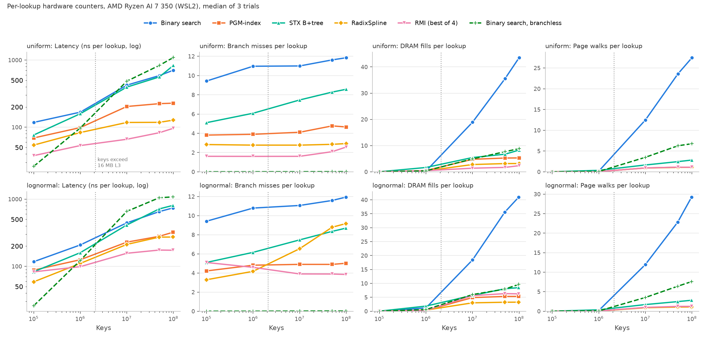
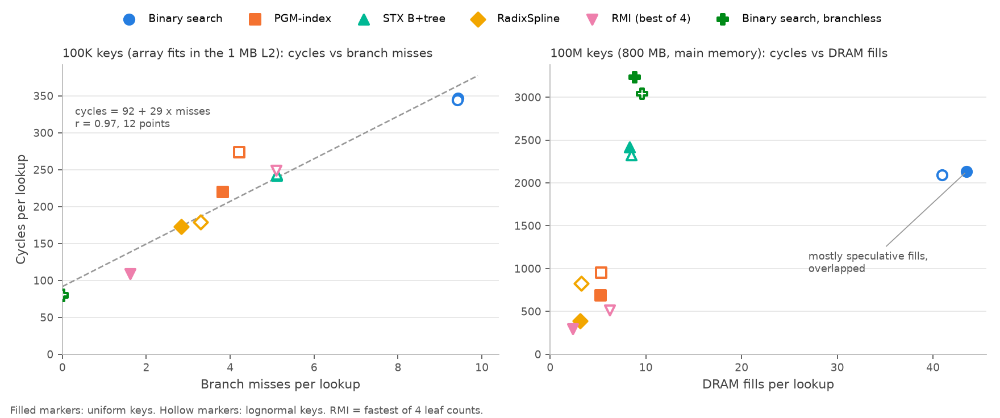

# Objective 3: Hardware counters

*Draft. Every number comes from `wp3/runs/20261126-205955-ryzen-wsl/summary/wp3_summary.csv`, which `wp3/scripts/summarize_wp3.py` checked against the raw trial files (all checks pass). A copy of the summary and the figures is in `report/figures/objective3/`.*

## 3.1 Method

We measured, per lookup, where the time goes: instructions, branch misses, and where each cache miss was served from.

- **Machine.** The AMD Ryzen AI 7 350 laptop that produced the x86 results in Objective 5.
  - Ubuntu 24.04 under WSL2 (Linux 6.6, a Hyper-V virtual machine), 7 GiB visible to Linux.
  - g++ 13.3 with `-O3 -march=native -std=c++17 -DNDEBUG`. AC power, Windows "Balanced" power plan.
  - Caches reported by Linux: 48 KiB L1d and 1 MiB L2 per core, 16 MiB L3. Pages are 4 KiB; the benchmark does not request huge pages.
- **Counters.** The benchmark (`wp3/src/wp3_perf.cpp`) reads the counters itself with `perf_event_open`, around the lookup loop only. Key generation and index building are not counted, and only user-space events are counted.
  - Generic events: cycles, instructions, branches and branch misses.
  - AMD raw events from the processor manual: demand data-cache fills by source (event 0x43: from the L2, from the L3, from another core complex's cache, from DRAM), and L1 data-TLB misses (event 0x45), including those that also miss the L2 TLB and need a page walk.
  - The virtual machine exposes only the core's counters, not the L3's own counters. We therefore count last-level cache misses as demand fills from DRAM.
- **Workload.** The same keys and queries as Objective 5: uniform and lognormal(0, 2) keys at 100K, 1M, 10M, 50M and 100M keys, and 2M random lookups of existing keys. The key counts equal those of the Objective 5 Ryzen run at every size.
- **Indexes.** All return the position of the key in the sorted array.
  - Binary search: `std::lower_bound`, as in Objective 5.
  - Branchless binary search, as a control. It does the same comparisons, but the compiler turns the choice of half into a conditional move. It had 0.00 to 0.02 branch misses per lookup, which confirms this.
  - RMI [1]: the two-stage linear RMI of Objective 5, code copied unchanged, at the same 4 leaf counts. As in Objective 5, we report the fastest.
  - PGM-index [3] with ε = 64 (commit `c6fcf3d`, as in Objective 4).
  - RadixSpline [4] with 18 radix bits and maximum error 32, the library defaults (commit `ab96aa5`).
  - STX B+tree 0.9 with default node sizes (the copy shipped with SOSD).
  - Every index returned the same position as binary search for all 2M queries, at every size and in every trial.
- **Repeats.** For each dataset, size and index: 1 warm-up pass, then 5 passes for each of 3 event groups. Each group fits in the hardware counters, so no event was multiplexed (the kernel reported full counting time). A value is the median of the 5 passes, divided by 2M. The reported value is the median of 3 trials, each a separate run of the program.
- **Calibration.** Before the trials, a pointer chase tests the events inside the virtual machine. It follows a random cycle through memory of a known size, one dependent load per step. Table 3.1 shows that each size is served by the expected cache level. So the fill events can be read as "where the data came from".

**Table 3.1. Calibration: one dependent load per step, counts per load.**

| Memory touched | ns per load | Cycles | Fills from L2 | Fills from L3 | Fills from DRAM | Page walks |
|---|---:|---:|---:|---:|---:|---:|
| 32 KiB (fits L1) | 1.5 | 5 | 0.00 | 0.00 | 0.00 | 0.00 |
| 512 KiB (fits L2) | 5.8 | 19 | 0.99 | 0.01 | 0.00 | 0.00 |
| 4 MiB (fits L3) | 17.6 | 57 | 0.13 | 0.85 | 0.00 | 0.16 |
| 1 GiB (main memory) | 249 | 781 | 0.00 | 0.00 | 1.00 | 0.99 |

## 3.2 Results

**Table 3.2. 100K keys: the 0.8 MB array fits in the 1 MB L2. Per lookup. No index fetched more than 0.03 lines from DRAM.**

| Keys | Index | ns | Cycles | Instructions | Instructions per cycle | Branch misses | Fills from L2 | Fills from L3 |
|---|---|---:|---:|---:|---:|---:|---:|---:|
| uniform | Binary search (`std::lower_bound`) | 117.9 | 346 | 169 | 0.49 | 9.4 | 15.3 | 1.5 |
| uniform | Binary search, branchless | 26.1 | 79 | 151 | 1.90 | 0.0 | 5.3 | 0.4 |
| uniform | STX B+tree | 76.5 | 242 | 176 | 0.73 | 5.1 | 5.2 | 2.0 |
| uniform | PGM-index | 69.2 | 220 | 142 | 0.65 | 3.8 | 4.7 | 0.6 |
| uniform | RadixSpline | 54.1 | 173 | 122 | 0.70 | 2.8 | 2.8 | 1.6 |
| uniform | RMI (1,562 leaves) | 37.7 | 109 | 73 | 0.67 | 1.6 | 1.8 | 0.4 |
| lognormal | Binary search (`std::lower_bound`) | 117.2 | 344 | 169 | 0.49 | 9.4 | 15.7 | 1.2 |
| lognormal | Binary search, branchless | 25.9 | 81 | 151 | 1.87 | 0.0 | 5.3 | 0.4 |
| lognormal | STX B+tree | 83.0 | 243 | 176 | 0.72 | 5.1 | 5.0 | 2.1 |
| lognormal | PGM-index | 87.8 | 273 | 188 | 0.69 | 4.2 | 4.8 | 0.9 |
| lognormal | RadixSpline | 58.8 | 179 | 126 | 0.70 | 3.3 | 2.9 | 0.7 |
| lognormal | RMI (1,562 leaves) | 82.8 | 249 | 123 | 0.49 | 5.1 | 10.6 | 1.1 |

**Table 3.3. 100M keys: the 800 MB array is in main memory. Per lookup. The last column divides latency by DRAM fills.**

| Keys | Index | ns | Instructions | Branch misses | Fills from L3 | Fills from DRAM | Page walks | ns per DRAM fill |
|---|---|---:|---:|---:|---:|---:|---:|---:|
| uniform | Binary search (`std::lower_bound`) | 707 | 263 | 11.9 | 11.7 | 43.5 | 27.5 | 16 |
| uniform | Binary search, branchless | 1,094 | 231 | 0.0 | 4.6 | 8.8 | 6.8 | 124 |
| uniform | STX B+tree | 832 | 277 | 8.6 | 4.1 | 8.3 | 2.8 | 100 |
| uniform | PGM-index | 228 | 195 | 4.7 | 0.2 | 5.3 | 1.1 | 43 |
| uniform | RadixSpline | 128 | 123 | 2.9 | 2.1 | 3.2 | 1.1 | 40 |
| uniform | RMI (97,656 leaves) | 96 | 91 | 2.6 | 1.1 | 2.3 | 1.1 | 41 |
| lognormal | Binary search (`std::lower_bound`) | 740 | 263 | 11.9 | 11.7 | 41.0 | 29.2 | 18 |
| lognormal | Binary search, branchless | 1,081 | 231 | 0.0 | 4.2 | 9.6 | 7.6 | 112 |
| lognormal | STX B+tree | 807 | 277 | 8.7 | 3.8 | 8.5 | 2.8 | 95 |
| lognormal | PGM-index | 321 | 239 | 5.0 | 0.2 | 5.3 | 1.1 | 61 |
| lognormal | RadixSpline | 273 | 275 | 9.2 | 6.2 | 3.3 | 1.1 | 84 |
| lognormal | RMI (1,533,381 leaves) | 174 | 104 | 3.8 | 0.6 | 6.2 | 1.2 | 28 |

**Figure 3.1.** Latency, branch misses, DRAM fills and page walks per lookup against key count. The dotted line marks where the keys exceed the 16 MB L3. "RMI" is the fastest of 4 leaf counts.

**Figure 3.2.** Cycles per lookup against branch misses at 100K keys (left, with a least-squares line), and against DRAM fills at 100M keys (right).

## 3.3 Findings

1. **In cache, branch misses set the cost, not cache misses.**
   - At 100K keys no index goes to main memory. Across the six indexes and two datasets, cycles per lookup follow branch misses closely: cycles ≈ 92 + 29 × branch misses (r = 0.97, 12 points; Figure 3.2, left).
   - `std::lower_bound` mispredicts 9.4 of its 17 comparisons per lookup, about half, as expected for random keys.
   - The branchless binary search makes the same comparisons without mispredicting and is 4.5× faster (26 vs 118 ns). The difference, (346 - 79) / 9.4, is about 28 cycles per branch miss.
   - At 100K keys the branchless search is the fastest index, ahead of the best RMI on both datasets (26 vs 38 ns on uniform keys, 26 vs 83 ns on lognormal keys).
   - So, on this CPU, the RMI's in-cache win over binary search in Objective 5 (3.3× uniform, 1.4× lognormal at 100K keys) is mostly a win over branch misses. Writing binary search without the branch removes it.
   - This holds only while the array fits in the L2. At 1M keys (8 MB, in the L3), the RMI is again the fastest: 53 vs 97 ns on uniform keys and 99 vs 122 ns on lognormal keys against the branchless search.
2. **Out of cache, the number of dependent memory accesses sets the cost.**
   - At 100M keys, the learned indexes fetch the fewest lines from DRAM: 2.3 to 6.2 per lookup for the RMI, 3.2 to 3.3 for RadixSpline, 5.3 for PGM. Each needs about one page walk. The B+tree fetches 8.3 to 8.5 lines and needs 2.8 page walks.
   - The branchless binary search fetches 8.8 to 9.6 lines from DRAM, roughly the last 9 of its 27 levels. Each load depends on the previous comparison, so the loads cannot overlap. It is the slowest index (1,081 to 1,094 ns, 112 to 124 ns per fill).
   - `std::lower_bound` fetches 41 to 44 lines and needs 27 to 29 page walks per lookup, yet it is 1.5× faster than the branchless version (707 vs 1,094 ns on uniform keys). It guesses each comparison and loads ahead along the guessed path. Most of these loads are discarded, but the correct ones arrive early, so the extra DRAM traffic costs little time (16 to 18 ns per fill). Removing the branch helps in cache and hurts in main memory.
   - So the number of DRAM fills alone does not predict latency (Figure 3.2, right). What matters is how many misses each lookup must wait for one after another. The learned indexes pay 28 to 61 ns per DRAM fill (RadixSpline on lognormal keys, 84 ns). The B+tree pays 95 to 100 ns, because each node's address is known only after the previous node arrives.
   - This supports the explanation proposed in Objective 5: a model replaces a chain of about 9 dependent misses with a prediction and a short search in one place. At 100M keys the RMI is 8.6× faster than the B+tree on uniform keys (96 vs 832 ns) and 4.7× faster on lognormal keys (174 vs 807 ns).
3. **A less accurate model turns into more memory traffic.**
   - On 100M lognormal keys, the RMI's DRAM fills grow with its last-mile search window. With 1.5M leaves (37 MB), the window averages 2^6.6 keys, and a lookup takes 6.2 DRAM fills and 174 ns. With 24K leaves (0.6 MB), the window averages 2^11.9 keys, and a lookup takes 32.9 fills and 437 ns. (Window sizes are the `avg_log2_err` column of the Objective 5 CSV, same keys and code.)
   - On uniform keys the model stays accurate at every setting (windows of 2^3.2 to 2^6.2 keys, 2.1 to 3.5 DRAM fills at 100M keys).
   - For Objective 2, this is the memory-for-speed trade inside a single learned index: more leaves cost memory and save DRAM fills.
   - RadixSpline on lognormal keys pays differently: few DRAM fills (3.3) but 9.2 branch misses and 275 instructions per lookup at 100M keys, against 2.9 and 123 on uniform keys. This fits a longer search among spline points where the skewed keys crowd a few radix buckets. We did not instrument the library to confirm this.

**Open question for Objective 5.** The M6's in-cache binary search (25.5 and 24.7 ns at 100K keys) runs at the speed of our branchless search on the Ryzen (26.1 and 25.9 ns), not of `std::lower_bound` (117 to 118 ns). One possible cause is that Apple clang compiles `std::lower_bound` without a branch on ARM64. If so, part of the M6's in-cache lead, and the RMI's loss there, comes from the compiled code rather than the hardware alone. We have not checked this. The check is to disassemble the M6 build of `learned-index-bench` (`otool -tv bench`) and look for a conditional select (`csel`) in the search loop.

## 3.4 Limitations

- **A virtual machine, not native Linux.** WSL2 runs Linux in a Hyper-V virtual machine.
  - The calibration (Table 3.1) shows that the core's counters work correctly inside it.
  - Pinning fixes the virtual CPU, but Windows may still move it between physical cores during a run.
  - Page walks in a virtual machine go through two sets of page tables, so they cost more than on native Linux.
  - Latencies here are 1.06× to 1.45× those of the native Windows run in Objective 5. The gap is largest for binary search at 10M keys and above (1.28× to 1.45×, where it does 12 to 29 page walks per lookup) and smaller for the RMI (1.15× to 1.34×). Counts of instructions, branch misses and fills do not depend on this.
- **Clock speed was not fixed.** Cycles divided by time give 2.7 to 3.3 GHz across the run. The three trials differ in latency by a median of 1.18× (worst row 2.5×). The counts are far more stable: instructions are identical in every trial, branch misses differ by at most 4%, and DRAM fills by a median of 7%. Our conclusions rest on the counts and on latency gaps of 1.5× or more.
- **No direct L3 counter.** We count last-level misses as demand fills from DRAM. These exclude hardware prefetches and include loads on wrongly guessed paths. That is why `std::lower_bound` shows more DRAM fills than it has levels.
- **Scope.** One CPU (macOS has no access to these counters, and the Intel laptop was not measured). Synthetic keys only, up to 100M keys: the four 200M-key SOSD datasets are not on this laptop, and we estimate that building the B+tree over 200M keys would exceed the 7 GiB the virtual machine has. No hash table.
- **Independent lookups.** As in Objective 5, consecutive lookups do not depend on each other, so the core can overlap one lookup's misses with the next one's. A workload where each lookup depends on the previous result would pay more per miss.
