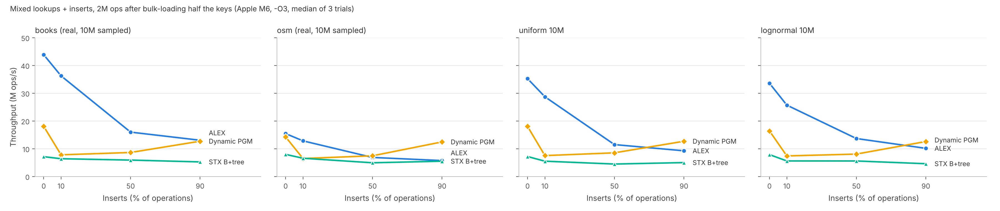
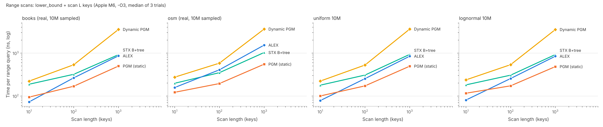
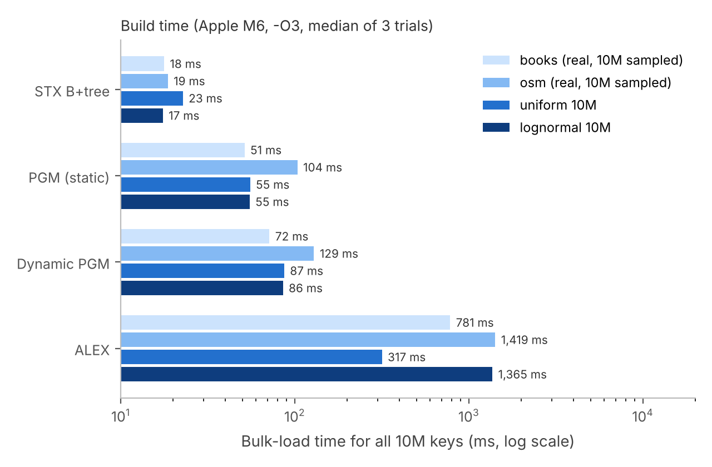

# Objective 4: Where learned indexes fall short

*Every number comes from `wp4/runs/20261125-111310-m6/summary/wp4_summary.csv`, which `wp4/scripts/summarize_wp4.py` checked against the raw logs. An earlier run (`20261125-104356-m6`, on battery, synthetic data only) replicates the synthetic results; see 4.1.*

## 4.1 Method

Lookup benchmarks such as SOSD study read-only, static data. We asked what happens to a learned index when the data changes, when queries ask for ranges instead of single keys, when the index must first be built, and when the keys are hard to model. We compared one updatable learned index, ALEX [5], against a conventional STX B+tree. We also compared it against PGM-index [3] in two forms: the static `PGMIndex` (ε = 64) over a sorted array, and the updatable `DynamicPGMIndex`. All four ran inside one C++ driver (`wp4/src/wp4_bench.cpp`) on identical, pre-generated operation sequences.

- **Mixed workload.** Bulk-load a random half of the keys, then run 2,000,000 operations, of which 0%, 10%, 50% or 90% are inserts. Inserts take new keys from the unloaded half in random order. The remaining operations are point lookups of loaded keys.
- **Range scans.** Find the first key ≥ a start key drawn from the data, then sum the payloads of the next L = 10, 100 or 1000 keys. This uses 200K queries for L = 10 and 100, and 20K for L = 1000.
- **Build time.** Bulk-load all keys from a sorted array.

**Correctness.** Every index returns a checksum of the payloads it read. For every workload, dataset and trial, all indexes returned identical checksums, so they did the same work.

**Data.** We used four 10M-key datasets:

- **Real data from SOSD [ref].**
  - `books_800M_uint64` (Amazon book popularity), which is easy to model.
  - `osm_cellids_800M_uint64` (OpenStreetMap cell IDs), which is hard to model.
  - Both files were downloaded from Harvard Dataverse, and their MD5s match the values SOSD publishes.
  - The driver sorts and de-duplicates each file, then keeps 10,000,000 evenly spaced distinct keys (a fixed stride, so the sample is deterministic). Their sha256s are `ef35edc5…` (books) and `334f0055…` (osm).
- **Synthetic data from `wp4/src/gen_data.cpp`.**
  - Uniform 50-bit keys (seed 1, 10,000,000 unique). This file is bit-identical across platforms.
  - Lognormal(0, 2) × 10⁹ (seed 2, 9,980,950 unique). This file differs between macOS and Linux in 3 of 9,980,950 keys, each by 1, because their math libraries round differently.

The sha256 of every input file is recorded with the run.

**Platform.**
- Hardware: Apple M6 MacBook Pro (Mac18,1, 16 GB, 20 MB L2 per CPU cluster per `sysctl`).
- Software: macOS 27.2.1, Apple clang 17, `-O3 -mcpu=native`, single thread.
- Each number is the median of 3 trials.
- The laptop was on AC power. macOS does not allow pinning a thread to a core.

**Replication.** We had already run the same synthetic workloads on battery power. Across the 56 synthetic-data results present in both runs, the median difference between runs is 3.4%. 49 of 56 differ by at most 10%, and the largest difference is 22.9% (B+tree, uniform, 50% inserts). Every conclusion below holds in both runs.

**Porting ALEX.** ALEX does not build on ARM: it uses x86 bit-counting intrinsics and the `cpuid` instruction. We replaced them with portable compiler builtins that have the same semantics (`wp4/patches/alex-0001-…`). ALEX's own unit test suite passes on ARM64 with the patch: 42/42 test cases, 42,490 assertions.

## 4.2 Results

**Table 4.1. Mixed lookups and inserts, throughput in million operations per second (higher is better).** Best per row in bold.

| Dataset | Inserts | ALEX | B+tree | Dynamic PGM |
|---|---:|---:|---:|---:|
| books | 0% | **43.8** | 7.1 | 18.1 |
| books | 10% | **36.2** | 6.4 | 7.8 |
| books | 50% | **16.0** | 5.9 | 8.6 |
| books | 90% | **13.0** | 5.2 | 12.7 |
| osm | 0% | **15.4** | 8.0 | 14.2 |
| osm | 10% | **12.8** | 6.6 | 6.5 |
| osm | 50% | 6.9 | 4.9 | **7.4** |
| osm | 90% | 5.7 | 5.5 | **12.4** |
| uniform | 0% | **35.2** | 7.2 | 18.0 |
| uniform | 10% | **28.7** | 5.5 | 7.5 |
| uniform | 50% | **11.5** | 4.5 | 8.5 |
| uniform | 90% | 9.2 | 5.0 | **12.7** |
| lognormal | 0% | **33.6** | 7.9 | 16.4 |
| lognormal | 10% | **25.7** | 5.6 | 7.4 |
| lognormal | 50% | **13.7** | 5.6 | 8.1 |
| lognormal | 90% | 10.1 | 4.6 | **12.6** |

**Table 4.2. Range scans, nanoseconds per query (lower is better).** Best per row in bold.

| Dataset | Scan length | ALEX | B+tree | PGM (static) | Dynamic PGM |
|---|---:|---:|---:|---:|---:|
| books | 10 | **73** | 188 | 94 | 222 |
| books | 100 | 265 | 320 | **169** | 535 |
| books | 1000 | 861 | 917 | **498** | 3,546 |
| osm | 10 | 158 | 198 | **122** | 275 |
| osm | 100 | 407 | 349 | **195** | 582 |
| osm | 1000 | 1,529 | 1,028 | **550** | 3,615 |
| uniform | 10 | **78** | 179 | 100 | 223 |
| uniform | 100 | 254 | 307 | **172** | 526 |
| uniform | 1000 | 845 | 931 | **495** | 3,617 |
| lognormal | 10 | **81** | 182 | 116 | 237 |
| lognormal | 100 | 256 | 306 | **173** | 537 |
| lognormal | 1000 | 844 | 922 | **483** | 3,526 |

**Table 4.3. Bulk-load time for all 10M keys, milliseconds (lower is better).**

| Dataset | B+tree | PGM (static) | Dynamic PGM | ALEX | ALEX ÷ B+tree |
|---|---:|---:|---:|---:|---:|
| books | **18** | 51 | 72 | 781 | 44× |
| osm | **19** | 104 | 129 | 1,419 | 76× |
| uniform | **23** | 55 | 87 | 317 | 14× |
| lognormal | **17** | 55 | 86 | 1,365 | 78× |

**Figure 4.1.** Throughput of mixed lookups and inserts versus insert fraction, per dataset (data of Table 4.1).

**Figure 4.2.** Time per range query versus scan length, log–log (data of Table 4.2).

**Figure 4.3.** Bulk-load time for all 10M keys, log scale (data of Table 4.3).

## 4.3 Findings

1. **Hard-to-model data takes away most of ALEX's lookup advantage.**
   - With no inserts, ALEX reaches 43.8 M ops/s on books but only 15.4 on osm, 2.8× lower. The B+tree is not slower on osm (8.0 vs 7.1 M ops/s).
   - ALEX's lead over the B+tree therefore shrinks from 6.2× on books to 1.9× on osm.
   - osm is also the one dataset where ALEX loses range scans to the B+tree: at L = 100 (407 vs 349 ns) and at L = 1000 (1,529 vs 1,028 ns, 1.5× slower).
   - The SOSD lookup results already showed osm to be the hard case for learned indexes. WP4 shows that the same holds for an updatable learned index, and for scans as well as point lookups.
2. **Inserts erode ALEX's lead over the B+tree.**
   - ALEX's own throughput falls 2.7–3.8× from read-only to 90% inserts.
   - Its lead over the B+tree shrinks from 4.3–6.2× at 0% inserts to 1.9–2.5× at 90% on books, uniform and lognormal.
   - On osm the two effects combine, and at 90% inserts ALEX and the B+tree are effectively tied (5.7 vs 5.5 M ops/s, 1.04×).
   - This is consistent with the node expansions and retraining that inserts trigger in ALEX's design [5]. We did not instrument these internals.
3. **At insert-heavy mixes, a different learned design wins.**
   - At 90% inserts, Dynamic PGM is faster than ALEX on osm (2.2×), uniform (1.4×) and lognormal (1.2×), and ties it on books (12.7 vs 13.0 M ops/s).
   - Its log-structured levels absorb inserts cheaply, and its 90%-insert throughput is nearly the same on every dataset (12.4–12.7 M ops/s).
   - At 10% inserts it is among the slowest indexes (6.5–7.8 M ops/s).
   - No single index is best across the whole range.
4. **Learned models help find the first key, not scan the rest.**
   - On books, uniform and lognormal, ALEX answers L = 10 scans fastest, 2.3–2.6× faster than the B+tree.
   - As scans get longer, finding the start matters less and the scan itself dominates. At L = 1000, ALEX is only 1.07–1.10× faster than the B+tree on those datasets.
   - A static PGM over a plain sorted array is then 1.7× faster than ALEX, and 2.8× faster on osm. This is consistent with ALEX's gapped leaf arrays, which reserve empty slots for future inserts that a scan must skip.
   - Dynamic PGM is 6.6–7.3× slower than static PGM at L = 1000, because its iterator must merge several sorted levels.
5. **Build time is ALEX's clearest weakness, and it depends on the data.**
   - ALEX takes 14× longer to bulk-load than the B+tree on uniform keys, 44× on books, and 76–78× on osm and lognormal (1,419 vs 19 ms on osm).
   - Going from books to osm makes ALEX's build 1.8× slower, as it does for both PGM variants (2.0× static, 1.8× dynamic). The B+tree barely changes (1.05×).
   - Build cost and lookup difficulty are separate signals. Lognormal keys make ALEX's build as slow as osm does, yet ALEX's read-only lookups on lognormal (33.6 M ops/s) are close to uniform (35.2), not osm (15.4).

## 4.4 Limitations

- **One machine, light statistics.**
  - All WP4 and ARM64 results come from one Apple M6 laptop with no thread pinning, using medians of 3 trials.
  - 71% of results have their slowest trial within 10% of the median. Individual trials sometimes spiked: up to 2.1× the median for timed operations (one B+tree scan trial), and 1.3× for builds.
  - Differences under about 10% should not be read as significant.
- **Real datasets are sampled.**
  - books and osm were reduced from 800M keys to 10M evenly spaced distinct keys, to match the synthetic sets and the laptop's 16 GB of memory.
  - Sampling preserves the shape of the key distribution but makes it coarser. At 800M keys, the indexes would also be much larger than the 20 MB L2 cache, so absolute numbers would differ.
- **Limited workload shapes.**
  - Inserts are random keys drawn from the same dataset as the loaded keys. We did not test sequential or append-only inserts, distribution shift, or deletes, which are known stress cases for learned indexes.
  - Range start keys always exist in the data.
- **Default configurations.**
  - The STX B+tree, ALEX and Dynamic PGM ran with library defaults, and static PGM used ε = 64. We did not tune node sizes, so a tuned B+tree could narrow the gaps.
  - Memory footprint was not measured in WP4 (see Objective 2).
- **The ARM64 SOSD port is partial.** RMI, ALEX, TS, CHT, ART and FAST are compiled out of SOSD on Apple Silicon. ALEX was therefore benchmarked in our own driver rather than in SOSD, and its numbers are not directly comparable with the SOSD lookup tables.
- **No hardware counters.** `perf` requires native Linux, so these results are not broken down into cache misses or branch mispredictions (Objective 3).
- **One dataset cannot be regenerated.** The 1M-key lognormal dataset behind the earlier SOSD ARM64 results was produced by a script whose seed and parameters were not recorded. Its keys are preserved, but it cannot be regenerated. All WP4 data is either seeded or checksummed.
