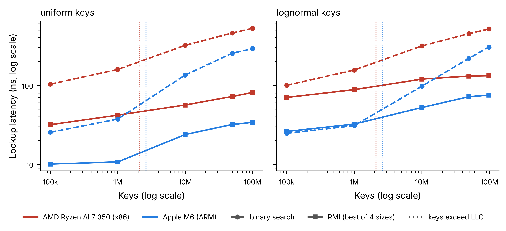
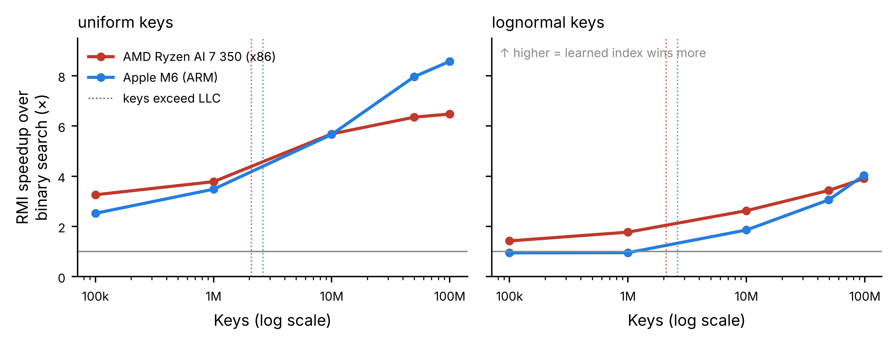

# Objective 5: Do learned indexes win on every CPU?

*Draft. Every number comes from `learned-index-bench/results/*.csv`, summarized by `learned-index-bench/compare_cpus.py` into `report/figures/objective5/wp5_summary.csv`. Two CPUs so far; an Intel laptop is still missing (see 5.4).*

## 5.1 Method

Every teammate runs the same benchmark, `learned-index-bench/bench.cpp`, on their own laptop. It compares a two-stage linear RMI (Kraska et al.) with plain binary search over sorted 64-bit keys.

- **Datasets.** Uniform and lognormal(0, 2) keys at five sizes, from 100K to 100M keys.
  - The keys are generated in the benchmark from a fixed seed and de-duplicated.
  - The key counts match across machines to within 2 keys (out of up to 100M).
- **Measurement.** Each result is the median of 5 runs, after 1 warm-up run. Each run is 2M random lookups of existing keys.
- **RMI settings.** The RMI is tried at 4 leaf counts. We report the fastest per size.

| | AMD Ryzen AI 7 350 | Apple M6 |
|---|---|---|
| Architecture | x86-64 | ARM64 |
| Last-level cache | 16 MB L3 (from the benchmark README) | 20 MB L2 per CPU cluster (`sysctl`) |
| Compiler and flags | not recorded | Apple clang 17, `-O3 -mcpu=native` |
| Thread pinning | pinned (`--pin`) | not possible on macOS |
| Power | not recorded | battery |

The 8-byte keys alone fill the last-level cache at about 2.1M keys on the Ryzen and 2.6M keys on the M6. The dotted lines in the figures mark these points.

## 5.2 Results

**Table 5.1. Median lookup latency in ns. "RMI" is the fastest of 4 leaf counts. Speedup = binary search ÷ RMI.**

| Keys | Ryzen binary search | Ryzen RMI | Ryzen speedup | M6 binary search | M6 RMI | M6 speedup |
|---|---:|---:|---:|---:|---:|---:|
| uniform 100K | 103.4 | 31.7 | 3.3× | 25.5 | 10.1 | 2.5× |
| uniform 1M | 158.6 | 41.9 | 3.8× | 37.4 | 10.7 | 3.5× |
| uniform 10M | 320.1 | 56.3 | 5.7× | 134.9 | 23.8 | 5.7× |
| uniform 50M | 458.8 | 72.2 | 6.4× | 254.8 | 32.0 | 8.0× |
| uniform 100M | 525.5 | 81.1 | 6.5× | 290.8 | 33.9 | 8.6× |
| lognormal 100K | 99.9 | 70.2 | 1.4× | 24.7 | 26.1 | **0.95×** |
| lognormal 1M | 156.0 | 88.0 | 1.8× | 30.9 | 32.3 | **0.95×** |
| lognormal 10M | 314.5 | 119.7 | 2.6× | 97.2 | 52.3 | 1.9× |
| lognormal 50M | 449.1 | 130.8 | 3.4× | 218.7 | 71.6 | 3.1× |
| lognormal 100M | 514.8 | 131.8 | 3.9× | 303.8 | 75.3 | 4.0× |

**Figure 5.1.** Lookup latency against key count on each CPU, log–log. Dashed lines are binary search; solid lines are the fastest RMI setting. Dotted vertical lines mark where the keys exceed each CPU's last-level cache.

**Figure 5.2.** RMI speedup over binary search on each CPU. Above 1, the learned index is faster.

## 5.3 Findings

1. **The M6 is faster for both methods, by most when the data fits in cache.**
   - For binary search, the M6 is 4.0–5.1× faster than the Ryzen up to 1M keys. At 100M keys it is only 1.7–1.8× faster.
   - For the RMI, the M6 is 2.7–3.9× faster up to 1M keys, and 1.8–2.4× faster at 100M.
   - The gap shrinks once lookups have to go to main memory. This fits main-memory latency, not core speed, setting the cost at large sizes; we did not measure memory latency directly (Objective 3).
2. **On both CPUs, the learned index wins more as the data grows.**
   - The RMI's speedup over binary search climbs past the cache limit on both machines.
   - Uniform keys: the speedup rises from 3.3× to 6.5× on the Ryzen and from 2.5× to 8.6× on the M6.
   - Lognormal keys: it rises from 1.4× to 3.9× on the Ryzen and from 0.95× to 4.0× on the M6.
   - This matches the project's premise: a learned model saves the most when each binary-search step is a cache miss.
3. **Whether the learned index wins at small sizes depends on the CPU.**
   - With lognormal keys at 100K and 1M, the RMI is 5% slower than binary search on the M6 (26.1 vs 24.7 ns and 32.3 vs 30.9 ns). On the Ryzen it is still 1.4–1.8× faster.
   - Here the RMI's model is inaccurate: its last-mile search window averages 2^7–2^9 keys (the `avg_log2_err` column). Meanwhile, binary search over cache-resident keys is very fast on the M6.
   - So a hardware change alone can turn a learned-index win into a loss. "Learned indexes beat binary search" holds on these laptops only once the keys exceed the cache, or when the model is accurate (uniform keys).
4. **At large sizes, the learned index benefits more from the M6 than binary search does.**
   - At 100M uniform keys, the RMI is 2.4× faster on the M6 than on the Ryzen, while binary search is only 1.8× faster. So the RMI's speedup over binary search is higher on the M6 (8.6× vs 6.5×).
   - One explanation is that the RMI makes few, independent memory accesses, which a wide out-of-order core can overlap. We have no counter data to confirm this.

## 5.4 Limitations

- **Two CPUs, one per architecture.** The task plan asked for AMD, Intel and ARM. No Intel CSV has been pushed yet. To add one, `compare_cpus.py` takes another `"label|color|LLC bytes|csv"` argument.
- **Run conditions differ and are partly unrecorded.**
  - The Ryzen run was pinned. The M6 run was unpinned and on battery.
  - The Ryzen's operating system, compiler and power state are not recorded in the repository.
  - The Ryzen's own repeat runs show how much this matters. Unpinned, it was 8.5% slower on the median row and up to 1.59× slower; without the warm-up run, up to 1.41× slower on one row.
  - Cross-CPU ratios under about 1.5× should therefore be read with care. The 4–5× cache-resident gap and the speedup trends are far larger than this noise.
- **Noisy rows on the M6.** In 9 of 50 M6 rows, the slowest run was more than 1.2× the median. In one row it was 2.8× (an RMI setting at 100M uniform keys that is not the fastest one, so it is not in Table 5.1). Medians are robust to this, but the run should be repeated on AC power.
- **Synthetic data, one learned index.** learned-index-bench covers only RMI against binary search, on uniform and lognormal keys. Objectives 1 and 2 cover the other indexes and the real SOSD datasets.
